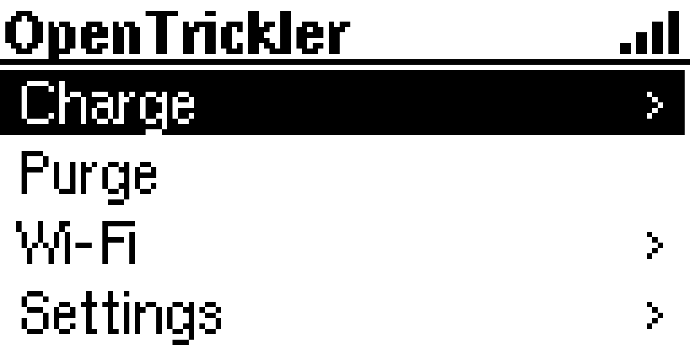
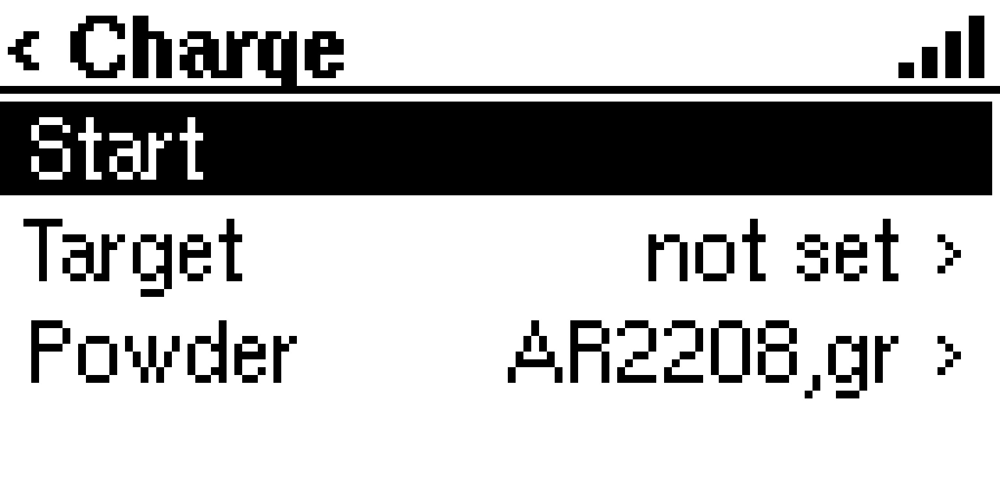
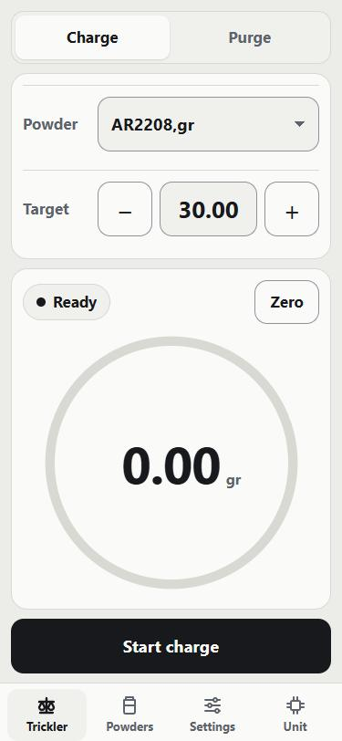

# OpenTrickler RP2040 Controller

This is the firmware for the controller of the [OpenTrickler](https://github.com/eamars/OpenTrickler), a powder trickler that weighs out a charge on a scale. It runs on a Raspberry Pi Pico W (RP2040) or Pico 2 W (RP2350) on the OpenTrickler's controller board.

Join our [Discord server](https://discord.gg/ZhdThA2vrW) for help and development news.

## What it does

- **Charges.** Set a target weight and a powder, put the cup on the scale, and the unit zeroes the scale, trickles the charge, asks you to take the cup off, and starts the next charge when the cup is back.
- **Calibrates and tunes itself.** A calibration measures the cup, the scale's lag and each powder's flow, and sets the charge's settings from them. With auto-tune switched on, the unit also tunes its control of the fine trickler as it charges.
- **Keeps up to eight powders,** each with its own settings.
- **Purges** the powder out of the trickler (the cleanup).
- **Has a web page** that works on a phone, a tablet or a computer: the charge with its live weight, the powders, every setting, and a backup of them. It needs no internet.
- **Sets itself up from a phone.** A new unit starts its own Wi-Fi hotspot and shows a code on its screen; scan it, and the page walks you through your Wi-Fi, the scale and the motors.
- **Updates over Wi-Fi.** The unit finds a new release on GitHub and offers it on its screen and its web page.
- **Has an API** for programs and agents: a REST API under `/api/v1` that describes itself, and a stream of events ([API v1](docs/developments_plans/ADR-003-http_rest_server/api_v1.md)).

| On the unit | On a phone |
|---|---|
| <br><br> |  |

## Supported hardware

- Raspberry Pi Pico W or Pico 2 W
- Mini 12864 display module, with its rotary encoder and three NeoPixel LEDs
- Two TMC2209 stepper drivers (STEP/DIR, with their one-wire UART)
- An optional servo gate: two miniature servos (TowerPro SG90/MG90S or similar)
- NeoPixel LEDs on the PWM3 output, up to 16
- The EEPROM on the controller board (CAT24C256, 256 kbit), which keeps the settings
- Wi-Fi, 2.4 GHz only

## Supported scales

| Scale | Reads | Zero from the unit | Serial settings |
|---|---|---|---|
| A&D FX-i series (standard format) | ✔️ | ✔️ | **19200** baud, 8N1 |
| Steinberg SBS | ✔️ | ❌ | 9600 baud, 8N1 |
| G&G JJ / JJB series | ✔️ | ✔️ (unreliable) | 9600 baud, 8N1 |
| U.S. Solid JFDBS | ✔️ | ❌ | 9600 baud, 8N1 |
| JM Science | ✔️ | ❌ | 9600 baud, 8N1 |
| Creedmoor Sports | ✔️ | ❌ | 9600 baud, 8N1 |
| Radwag R series | ✔️ | ✔️ | 9600 baud, 8N1 |
| Sartorius | ✔️ | ❌ (not yet, but doable) | 9600 baud, **7N1** |
| FA-E / FA-EN series (aelabgroup) | ✔️ | ❌ | 4800 baud or faster (the balance's default is 1200), 8N1 |
| Generic (the first number on each line) | ✔️ | ❌ | As the scale sends |

Setting a scale up for the OpenTrickler: [A&D FX-i](manuals/Scale-Settings) ([PDF](manuals/OpenTrickler%20manual%20for%20ADFX%20scale.pdf)), [G&G](manuals/configure_g&g_scales.md).

Your scale is not listed? Try the Generic make first; if it is not enough, [Adding support for a scale](docs/adding_a_scale.md) shows how to add one.

## Getting started

1. **Install the firmware** by USB: [Firmware update via USB](manuals/firmware_update_via_usb.md). The files are on the [releases page](https://github.com/eamars/OpenTrickler-RP2040-Controller/releases).
2. **Connect it to your Wi-Fi**: [OpenTrickler Wireless](manuals/connect_to_wireless.md).
3. **Set up your scale** (see its guide above), then choose it on the unit: **Settings › Scale**.
4. **Calibrate**: **Settings › Calibration** on the unit, or the web page's **Settings**.
5. **Charge**: **Charge** on the unit's main menu, or the web page's **Trickler**.

The unit's web page is at `http://opentrickler-XXXX.local`, where `XXXX` is the four characters the unit shows on its **Wi-Fi** page, along with its IP address.

## Building from source

The build runs on Windows and on Linux (CI builds on Linux with the same tools). Every tool's version is written once, in [`toolchain.env`](toolchain.env), and the setup scripts fetch exactly those.

Get the source with its submodules (the Pico SDK, FreeRTOS and LVGL):

```powershell
git clone --recursive https://github.com/eamars/OpenTrickler-RP2040-Controller
```

### On Windows

```powershell
.\setup_toolchain.ps1
```

This fetches the compiler, CMake, Ninja, picotool and OpenOCD into `%USERPROFILE%\.pico-sdk`, the folder the VS Code Raspberry Pi Pico extension also uses. Run it once, and again when `toolchain.env` changes. `-List` shows what it would fetch.

Then build for your board:

```powershell
.\build_pico_2w.ps1
```

```powershell
.\build_pico_w.ps1
```

The Pico 2 W's build goes into `build\`, the Pico W's into `build_w\`. Each makes `full_install.uf2`, the file you copy onto the Pico's USB drive.

To work in VS Code, start it with `.\run_vscode.ps1`, which sets up the environment first. Its CMake settings build for the Pico 2 W; change `PICO_BOARD` in `.vscode/settings.json` for the Pico W.

### On Linux

```bash
./setup_toolchain.sh
source ./configure_env.sh
cmake -B build -G Ninja -DCMAKE_BUILD_TYPE=Debug -DPICO_BOARD=pico2_w
cmake --build build
```

`setup_toolchain.sh` fetches the tools into `.toolchain/` in the repository. Use `-DPICO_BOARD=pico_w` for the Pico W.

### A release's files

`python scripts/build_release.py` builds both boards' full installs and update images into `release\`, with their `manifest.json` and `SHA256SUMS`, as CI does on every build.

## Working on the firmware

- **[AGENTS.md](AGENTS.md)** is the guide for anyone changing the firmware, person or agent: how the code is organised, the rules for settings stored in the EEPROM, the tests, and how a change is proven on a unit.
- **[docs/developments_plans](docs/developments_plans/README.md)** holds the decision records (ADRs): what was decided, why, and what was measured.
- **Without a unit:** `tests/host_test.py` runs the firmware's logic on a PC, and `tests/web_test.py` serves the web page against a recorded unit at http://127.0.0.1:8000/.
- **Releases** are made as [docs/releases](docs/releases/README.md) describes.

## License

See [LICENSE](LICENSE).
