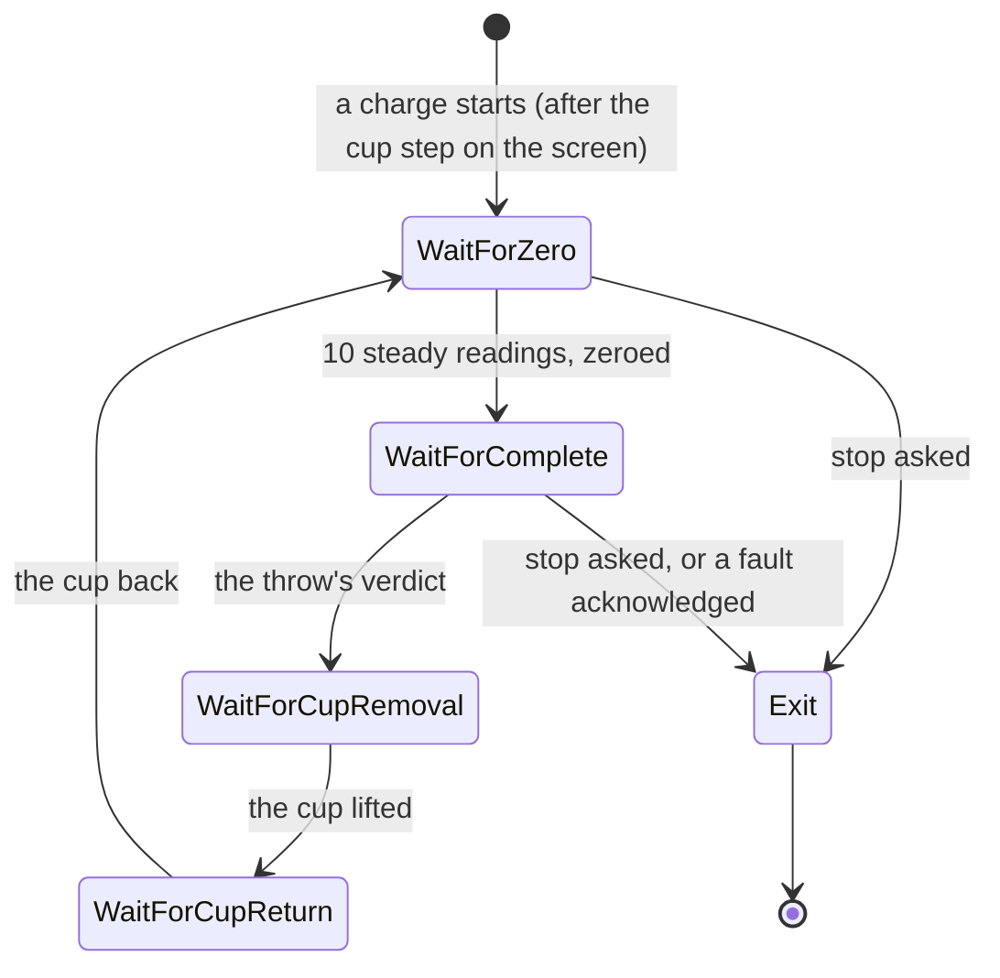
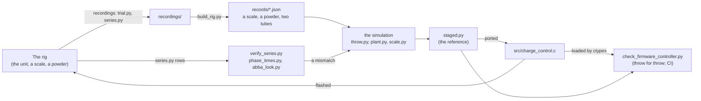

# How the charge controller works

A living description of the firmware's charge controller, for people and for AI agents who change, tune or operate it. It says what is built and points to where each part lives. What is proposed and not built is in [ADR-009's design draft](developments_plans/ADR-009-controller_and_tuning/controller_design_draft.md), never here.

**Keep it true:** a commit that changes how a throw is poured changes this page in the same commit (AGENTS.md). If this page and the code disagree, the code is right and this page is a bug.

## A throw, start to end

The charge is a state machine in `src/charge_mode.cpp`, run in the job task (`src/jobs.c`). A charge is a run of throws until it is stopped.

- **WaitForZero** waits for steady readings and zeroes. In a bench series (`charge <gr> series <n>`) it takes the steady weight as the next throw's base instead, and no cup is lifted.
- **WaitForComplete** is the pour, by one of three loops (next section), from the zero to a verdict.
- **WaitForCupRemoval** shows the verdict: over, under or good by the LEDs, and an event (`EVENT_FINISHED`) with the weight and the time.
  - The staged and `pid_learnt` loops are judged on their own rest weight, over or under from the band and half a digit.
  - Today's PID loop is judged on a reading a second after its stop, against the fine stop threshold.

## Which loop pours: `settings/charge controller`

| Choice | What it is | Needs | Status |
|---|---|---|---|
| `staged` (the default) | The staged controller: a forecast of the powder in the air, a glide to a creep, a stop a digit short, one settled reading, small moves to top up, a stop learnt throw by throw | The powder profile's calibration (else the start is refused, "Not calibrated") | ADR-009, gate 2, on the rig |
| `pid` | Today's loop, as it was: two PID loops on the reading, once a reading | The profile's gains | Kept as it is, neither deleted nor mended |
| `pid_learnt` | An experiment: today's PID settings on a forecast learnt from the throws, no calibration | The profile's gains | 2026-11-22; `research/pid_learning_2026-11-22.md` |

The choice is a byte in the charge settings' filler, so the stored record's size and CRC did not change. The band, `settings/charge mode` (`accurate` ±0.02 gr or `fast` ±0.04 gr), is a second byte there. Both are gate 2's temporary forms.

## The predictor: the powder in the air

A scale shows the cup's weight about half a second to a second late (the A&D FX-300i: about 0.6 s for a flow, longer for a small change from rest). A loop that acts on the reading pours on until the reading arrives. That is why today's PID loop is over: 9 throws of 10 at ±0.02 gr with the owner's gains on this rig, in the simulation.

The staged controller acts on a **forecast**: the reading plus what each tube has turned out that the reading does not show yet.
- Every 10 ms each tube's turns since the last parcel become a parcel: the turns × that tube's grains a turn, due to show after the lag the calibration measured at that tube's present speed.
- A reading takes off every parcel due by then.
- The turns are the unit's own step count, read every millisecond (`motor_get_steps_made`), not the speeds asked.

**An example,** this rig's calibration (2026-11-22): the fine tube pours 0.814 gr a turn. At its creep of 0.058 rev/s with a lag of about 0.9 s, about 0.04 gr is in the air at any moment: one band's worth. That is how the creep is chosen (next section).

`pid_learnt` has a simpler predictor with no calibration: the fine tube's turns over the last 0.9 s × one figure learnt from its throws (`src/charge_pid_learnt.c`). Given a coarse figure, it counts the coarse tube's forward turns over that tube's lag too. That one learnt figure is right only near the speed it was learnt at: the A&D lags longer at a low flow, so a figure learnt at the creep overstates the fine tube's powder in the air at 2 rev/s (rig, 2026-11-22: 1.5 to 2.1 gr a window-turn, where the tube pours about 0.8).

## The staged controller (`src/charge_control.c`)

A port of `tools/charge_sim/staged.py`, kept in its order so the two read side by side. It has no FreeRTOS, no motor and no scale in it: the simulation loads the same C as a library. Its call order is `start`, then every millisecond `count` (each tube's turns) and `tick`, each reading with `reading`. After each call the caller sets the speeds, or makes a small move of the fine tube as a count of steps.

**Its rules,** made at a charge's start from the profile's calibration, for the mode's band (`charge_control_set_rules`). On this rig at the fast band (`ccal load`, 2026-11-22):

| Rule | Value | Made from |
|---|---|---|
| floor (the creep) | 0.058 rev/s | the band ÷ (the slowest lag × fine grains a turn) |
| stop room | 0.0615 gr (then learnt) | the aim, a digit short, placed from the rehearsals' first errors |
| glide room | 0.193 gr | the stop room + twice a stop's spread at four times the floor |
| glide time | 0.53 s | 0.6 × the longest fine lag |
| coarse room | 1.44 gr | three times the coarse tube's spread + the glide room + 0.2 |
| coarse glide | 0.32 s | 0.6 × the coarse tube's lag |
| rest | 2.60 s | the slowest quiet time after a stop near the floor + 0.3 |

**The stream.** With `room` = the target − the forecast − three spreads of the coarse tube's unseen powder:
- coarse speed = (room − coarse room) ÷ (coarse grains a turn × coarse glide), between 0.3 and 2 rev/s, until the room is down to the coarse room. Then the coarse tube stops for good; it has no back-off.
- fine speed = (room − glide room) ÷ (fine grains a turn × glide time), between the floor and the fine top (0.5 rev/s by default; the rig's series ran 1.0).
- The fine tube stops when the room is down to the stop room, once the coarse tube's unseen powder is under a digit.

**The rest and the verdict.** The rest time after the stop, and no rise of half a digit for max(0.4 s, two intervals). Then:
- within the band and a quarter digit: **good**;
- above it: **over**;
- short:
  - by more than the stop room plus the largest move: back to the stream;
  - otherwise a small move, the largest whose mean release is at most halfway to the band's top, then a rest again;
  - at most 8 tries; then **short**.

**A real throw** (the night's glide block G2, throw 3: 9.98 gr in 8.8 s, `logs/adr009/20261122_192001_series_night_g2`):

| t (s) | Reading | Forecast | Coarse (rev/s) | Fine (rev/s) | What happens |
|---|---|---|---|---|---|
| 0.04 | 0.00 | 0.26 | 2.00 | 1.00 | both at their tops |
| 0.52 | 0.60 | 6.97 | 0.38 | 1.00 | the forecast is 6.4 gr ahead of the reading: the coarse tube slows |
| 1.00 | 5.90 | 8.22 | 0 | 1.00 | the coarse tube has stopped, 1.4 gr short by its forecast |
| 1.94 | 8.96 | 9.61 | 0 | 0.51 | the fine tube glides |
| 3.38 | 9.52 | 9.79 | 0 | 0.13 | |
| 5.30 | 9.86 | 9.90 | 0 | 0.058 | at its creep |
| 6.24 | 9.96 | 9.99 | 0 | 0 | stopped: the forecast is at the stop room |
| 8.82 | 9.98 | 9.98 | 0 | 0 | the verdict after the rest: good, −0.02 |

**Its second speed law** (`ccon speed_law=1`; an experiment of 2026-11-22, `research/pid_learning_2026-11-22.md`):
- **What changes:** today's PID loop pours the stream in place of the glide's law, on the same forecast:
  - the coarse tube's error is the room above the coarse room;
  - the fine tube's error is the room itself;
  - P every millisecond, I and D on each reading as today's loop takes them;
  - the gains are the powder profile's, its speeds within the motors' limits.
- **What stays the frame's:** the fine tube's least speed (the floor), the coarse tube's switch-off at the coarse room, the stop, the rest, the small moves and the stop's learning.
- **Its own carried stop:** its throws carry into a list of their own (EEPROM 21 K, one a profile), never the glide's. A PID-law charge places its stop from that list, or from the glide's while it is empty.
- **The envelope** (`ccon pid_envelope`, on by default), so gains bad to begin with cannot spoil the stop:
  - each tube never faster than the frame's top (`coarse_top_rps`, `fine_top_rps`, the speeds whose lags the calibration knows);
  - nor than the frame can stop it from: the fine tube its floor plus the room above the stop over its grains a turn × glide time, the coarse tube the glide's coarse law;
  - the I term counts only while its tube is not held at a limit.
  - On the rig with the bench unit's own stored gains (fine kp 2, top 3; coarse kp 0.025): 15 of 20 good, 5 over, 12.1 s, against the glide's 16, 4, 10.7 s. Gains too slow stay slow.
- **On the rig** (the owner's fine gains, the coarse tube's from the calibration: kp 0.306, 0.3 to 2 rev/s): 17 of 20 settled good, 3 over, 10.5 s, against the glide's 19, 1, 11.4 s.
- `check_firmware_controller.py --pid` checks it throw for throw against `staged.py`.

**The auto-tuner's offer** (`ctune`; an experiment of 2026-11-22):
- **What it is:** the PID law's gains made from the profile's calibration:
  - the coarse tube kp 1 / (grains a turn × coarse glide time), 0.3 to 2 rev/s;
  - the fine tube kp 0.6 / (grains a turn × glide time), its time constant its longest lag, the frame's floor and top;
  - no I or D.
- **Using it:** `ctune` shows the selected profile's PID settings ("set") against the offer. `ctune accept` writes the offer into the profile:
  - live; `setting powder_profiles/<n> save` keeps it;
  - refused while a job runs;
  - it forgets the PID law's carried stop for that profile.
- **On the rig:** 2 to 3 s a throw quicker than the glide, with more overs (14 and 15 of 20 good against 15 and 19).
- **Not on the screen or the web:** they wait for their design gate.

**What it learns:**
- **The stop.** At each throw's first rest, 15% of its first error against the aim moves the stop room (nothing under a quarter digit, at most 2 digits a throw).
- **The fine tube's figures** (`learn_fine_prior`, `learn_fine_split`, both on by default). Not to be trusted yet: they read through the fine tube's lag at 1 rev/s, which was never measured (`research/HANDOVER.md`).
- **The carry.** At a charge's end, its throws' first errors (from at least 5 throws that rested as they should, never the simulated scale) go into its law's list, the newest 16 kept, and the next charge of that law places its stop from them:
  - the glide's list is the calibration slot's, the PID law's its own;
  - each error is translated to the rules' own stop room, the one the rehearsals were thrown at, not the room as placed (mended 2026-11-22, 21:26: translated to the placed room, the stop jumped between sessions);
  - never more than 3 digits at once, but a law's first carry into an empty list is taken whole;
  - a temporary form.

## Today's PID loop (`charge_mode_wait_for_complete`, the `pid` choice)

Once a reading:
- the coarse PID aims at the target less the coarse stop threshold (5 gr by default), then stops and backs off (by default a quarter turn at 1 rev/s);
- the fine PID aims at the target from the start;
- everything stops when the reading is within the fine stop threshold (0.03 gr);
- with a servo gate: the gate moves to its coarse-stop ratio at the coarse stop, closes at the end, and the precharge pours onto the closed gate for the next throw.

**Known facts:**
- The speeds are clamped up to the motor's least speed (0.1 rev/s on the bench unit).
- The D term is taken per millisecond, so the profiles' Kd values add almost nothing.
- It cannot see the powder in the air, so it is over by about the flow at its stop × the scale's lag.

## The PID with a learnt forecast (`pid_learnt`, an experiment)

Today's loop's settings, with the frame added, and no calibration:
- the fine PID on the reading plus its learnt in-air powder;
- a stop a digit short;
- one settled reading;
- a top-up that runs the PID again;
- the figure learnt at each first rest (a mean of the throws so far, the newest at least 15%);
- the figure starts at 2.0, on purpose high, so that a fresh powder starts short, never over;
- the learnt figure is kept in RAM while the unit runs;
- with `cpid floor_band_share=1`, its least speed is set the glide's way, from the figure;
- with `cpid coarse_gr_turn=<x> coarse_lag_s=<x>`, the coarse tube's powder is in the forecast (its forward turns only: a back-off's steps are not powder), and with `coarse_margin_share` the glide's margin for it;
- the fine figure is learnt with the coarse tube's powder still in the air taken off, and not at all from a throw whose coarse margin is more than the band.
- Its coarse PID numbers can be set from the calibration (`series.py --profile-set`, `--charge-set`): on this rig kp 0.306, a stop 1.43 gr short, between 0.3 and 2 rev/s. The back-off is then turned off: the rig's coarse tube spills 0.83 gr of AR2209 a reverse (measured 2026-11-21), which a stop 1.43 gr short cannot absorb.

**A real throw** (the night's PID block P1, throw 5: 10.00 gr in 12.3 s, `logs/adr009/20261122_191245_series_night_p1`): the coarse tube at 0.25 to 0.10 rev/s (the owner's coarse kp of 0.05) until 2 s, the fine tube at 2 rev/s until 3.4 s, a P approach from 9.2 gr at 6 s, stopped at 9.76 s, the verdict at 12.3 s.

**Where its time goes, against the glide** (medians of 20 throws each, `bench/phase_times.py`):

| | Bulk, to within 0.7 gr | Approach, to the fine stop | Rest and top-ups |
|---|---|---|---|
| Glide | 3.20 s | 4.60 s | 2.58 s |
| `pid_learnt` | 7.77 s | 4.47 s | 2.54 s |

So the PID's time is in the bulk, by its coarse settings; its finish is the glide's.

With its coarse tube set from the calibration (2026-11-22, 19:51 to 20:04; 20 throws each):
- the PID: 19 settled good, 1 over, 14.8 s, bulk 6.2 s;
- the glide: 16 good, 4 over, 11.2 s, bulk 3.2 s.
- The coarse tube now stops about 2.5 gr early, because the fine tube's powder in the air at speed is forecast with the creep's figure. Accurate, and slow.

## Faults, and what the unit does today

| Fault | What the unit does | Where |
|---|---|---|
| No reading for 3 of the scale's usual intervals | Both tubes pause; the throw goes on when readings come back steady | ADR-013, `charge_mode_pause` |
| No reading for 10 intervals (at least 1 s), unsteady, unreliable | The charge ends in `fault`: tubes stopped, the gate closed, the screen says why | ADR-013 |
| A motor driver fault or a driver lost | The same, checked every 100 ms | ADR-012 |
| A reading 3 gr over the target, a throw past 120 s (and, in the staged controller, 15 fine turns) | Everything stops; the verdict "limit" | `charge_control.c`, `charge_pid_learnt.c` |
| A stop asked (a button, the API, the console) | Both tubes stop; the charge exits | `charge_mode_stop_asked` |
| A hard fault | The step pulses stop before the core halts | `fault_handler.c`, ADR-012 |

**Known gaps, not built:**
- **A cup lifted mid-throw is poured on at full speed by every loop.** It is a condition of ADR-009's sign-off.
- **An empty hopper** is noticed only by the time and turn limits.
- **`pid_learnt` learns from the simulated scale too.**

## Where the numbers live today

| What | Where | Written by | Read |
|---|---|---|---|
| Powder profiles: name, each tube's PID gains, least and top speeds (8 profiles) | EEPROM 9 K | screen, web, API | each throw |
| Charge settings: thresholds, back-off, precharge, `controller`, `mode` | EEPROM 5 K | screen, web, API | each charge or throw (`applies`) |
| Motor settings: least and top speeds, the gearing | EEPROM 4 K | screen, web, API | the motors' task |
| Servo gate: ends, speeds | EEPROM 10 K | screen, web, API | each move |
| A profile's calibration (measured, rehearsals' and the glide's carried first errors, finish, band) | EEPROM 13 to 20 K, a slot a profile | the console only (`ccal`), and the glide's carry | each charge's start |
| The PID law's carried first errors, a list a profile | EEPROM 21 K, one record | the PID law's carry | each PID-law charge's start |
| The staged controller's constants | RAM (`ccon`), defaults in `charge_control.c` | the console, never stored | each throw's start |
| `pid_learnt`'s constants and learnt figure | RAM (`cpid`) | the console, the learning | each throw |

- A factory reset erases the whole EEPROM.
- `GET /api/v1/settings` (and `rc_run.py settings --save`) copies every row above but the calibration slots and the RAM.

## The simulation and the unit

The algorithm is designed in a simulation and verified on the rig, not developed on the unit (the owner, 2026-11-20). The two are tied so a claim made in one is checked in the other.

- **The simulation** (`tools/charge_sim/`):
  - a millisecond a step: the tubes pour kernels and clumps (`plant.py`), the cup lands them, and the scale shows them late, filtered, rounded and at its own rhythm (`scale.py`);
  - a rig is a record measured from a unit, never set by hand (`records/`, `build_rig.py`);
  - `mc.py` throws a controller many times;
  - `controllers.py` names every controller tried.
- **The same C on both:**
  - `firmware_controller.py` builds `src/charge_control.c` with the PC's compiler pinned in `toolchain.env` (Zig), and the simulation throws it;
  - `check_firmware_controller.py` runs it against `staged.py` throw for throw, and CI runs its logic check;
  - `firmware_pid.py` does the same for `src/charge_pid_learnt.c` against `legacy_pid.LearntPid`.
- **Known limits of the simulation:**
  - its stops scatter less than the rig's (sd 0.028 gr against 0.046), so its good shares run about ten points high;
  - its fine tube cannot be trusted above 0.5 rev/s.
  - It ranks controllers and predicts times well, and is kind at the finish. Accuracy at the stop is the rig's to judge.
- **On the unit:**
  - `bench/series.py` throws a series through the console and keeps each throw's rows (`ccrec`);
  - `verify_series.py` checks a calibration against the throws;
  - `abba_look.py` and `phase_times.py` sum a side by side.

**A change to how a throw is poured goes in this order:**
1. the Python reference;
2. a simulation study with its passes written first;
3. the C port;
4. the throw-for-throw check;
5. a flash;
6. a series, or ABBA blocks against the default, judged against the passes;
7. the recordings kept, the verdict in the ADR's `progress.md`, this page updated.

The bench rules in `AGENTS.md` hold throughout, the owner's word that the bench is ready among them.

## Watching a unit

| Console (`rc_run.py send ...`) | What it gives |
|---|---|
| `state` | the charge's state, the weight, the version, the drivers |
| `setting settings/charge` | the controller, the mode, the thresholds |
| `ccal load` | the profile's calibration and the rules made from it (`@cal rules ...`) |
| `ccon`, `cpid` | the staged controller's constants (`speed_law` among them) and `pid_learnt`'s (and its learnt figure) |
| `charge <gr> series <n>` | n throws into one cup; a `Charge: throw ...` line each |
| `ccrec` | the last throw's rows: ms, reading, forecast, coarse and fine rev/s |

Over the web, `GET /api/v1` lists the unit's paths, and every GET changes nothing (`docs/developments_plans/ADR-003-http_rest_server/api_v1.md`).

## Words used here

- **band:** how far from the target a throw may rest and be good (0.02 or 0.04 gr).
- **digit:** the scale's smallest step (0.02 gr on the A&D).
- **forecast:** the reading plus the powder in the air.
- **lag:** how late the scale shows a flow.
- **floor, creep, least speed:** the fine tube's slowest speed in the stream, at which a stop's powder in the air is about one band.
- **stop room:** how far short of the target, by the forecast, the fine tube stops.
- **aim:** where the first rest is meant to lie (a digit short).
- **first error:** the first rest's weight less the target; what the stop learns from.
- **rest:** the wait after a stop before the verdict.
- **carry:** a charge's first errors kept in the profile's calibration for the next charge.
- **figure:** a tube's grains a turn (in `pid_learnt`: grains in the air a turn of its window).
- **ABBA:** blocks thrown in the order A, B, B, A, so a steady drift falls on both.
