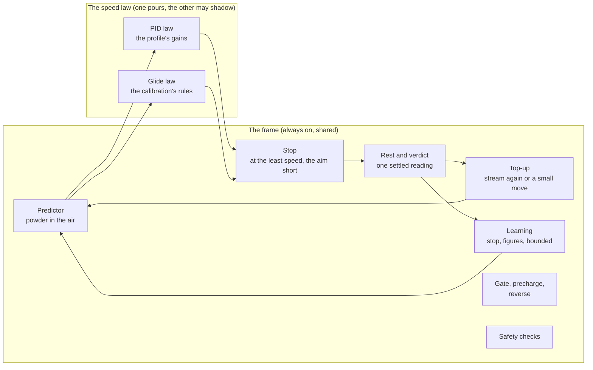
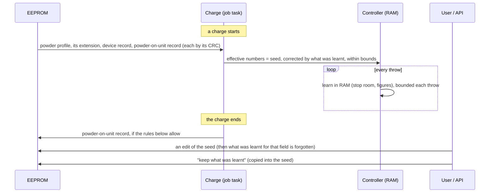
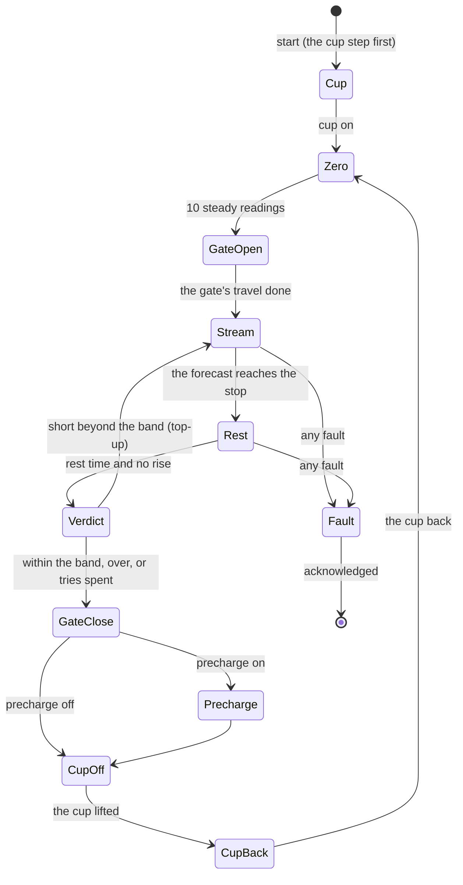

# ADR-009: one frame, two speed laws, a profile split by physics (a draft)

Status: **Draft** 2026-11-22, 19:45 NZDT. Not approved, and nothing here is built beyond the experiments it cites. It answers the README's "Open, to be discussed" item (a powder profile portable and shareable). That item **closes** when the owner has settled the decisions at the end of this page, before gate 3's calibration job writes a calibration of its own.

**Overridden in part, 2026-11-22, about 22:00,** by the README's "Sign-off: what ADR-009 delivers", which wins where the two differ:
- **One controller, no choice:** no `auto` per powder, no law a user pins; the speed laws are internal.
- **The user's PID values stay in the powder profile as they are,** corrected by the calibration and the auto-tuner. The draft's move of them out of the profile is withdrawn.
- **The existing settings are not legacy:** their function is kept.
- **A user's AI agent may change a unit's calibration and learnt data directly,** on the user's yes, through the API. Never during development.

**Superseded further, 2026-11-22, 22:46** (the README's "Where ADR-009 stands"):
- **The PID law pours;** the glide's parts are the frame around it. Every mention below of `auto`, of a law per powder or of a law a user pins is withdrawn: section "The design", the profile record's "its law", section 1's fallback, section 6's migration, and decision 4.
- **The auto-tuner writes the profile's PID values while it is on.** Decision 3's "learning never overwrites the seed" is withdrawn.
- **The band is the user's fine stop threshold,** not a profile's accurate or fast.
- **The frame's numbers are gate N's** ([numbers.md](numbers.md)); this draft's mentions of `ccon` and `cpid` constants are not their life cycle.

## What we want (the owner, 2026-11-22 night)

- "Use legacy PID parameter that people already uses, so they don't need to re-tune everything."
- "Build the autonomous predictor, auto PID tuner (calibration) and learning into the hybrid PID controller."
- "Make the parameter (at least the initial parameter) portable, and let the learning to autonomous overwrite the user's default parameter."
- Agreed after the night's runs:
  - split the profile by physics;
  - share the powder-specific part;
  - keep the scale's and the printed parts' properties on the unit, "none configurable (i.e., not through the interface, but we should allow the user to backup and restore)".
- "I don't want to throwaway the glide controller. We can always run two controllers in parallel, especially the predictor, and other non PID related, like reverse control and other advanced feature."
- Asked of this draft: the life cycle of every parameter; the failure modes and safety; manual tuning with the auto-tuner; when a throw starts and stops; the servo gate (issue #135); the legacy migration; the stored form; a live document of how the controller works.

## What we know

**From the rig** (Pico 2 W, A&D FX-300i, AR2209, 10 gr, judged at ±0.04 gr; `research/pid_learning_2026-11-22.md`):

| Controller (ABBA blocks, 20 throws each) | Settled good | Overs | Median | Bulk / approach / rest |
|---|---|---|---|---|
| First run (18:26 to 18:39): glide, calibrated | 18 | 2 | 10.9 s | 3.0 / 4.7 / 2.6 s |
| First run: PID with a learnt forecast, least speed 0.1 | 14 | 5 | 13.7 s | 6.8 / 3.6 / 2.5 s |
| Second run (19:10 to 19:22): glide | 15 | 5 | 11.0 s | 3.2 / 4.6 / 2.6 s |
| Second run: PID with a learnt forecast, its least speed learnt | 16 | 4 | 15.5 s | 7.8 / 4.5 / 2.5 s |

- **The accuracy comes from the frame,** not the speed law: the forecast, a stop at a least speed set from it, one settled reading, and the learning. With those, today's PID settings and no calibration were as accurate as the glide.
- **The time was lost in the bulk.** The owner's coarse kp (0.05) and coarse stop (5 gr) hold the coarse tube at 0.1 to 0.25 rev/s, where the glide runs it at 2 rev/s to 1.44 gr short. The approach and the rest took the same time in both. Whether coarse settings made from the calibration close the gap was tested the same night (19:51 to 20:04):
  - **Accuracy:** the PID 19 of 20 settled good, 1 over, against the glide's 16 and 4.
  - **Time:** 14.8 s against 11.2 s, the bulk still 3 s longer.
  - **Why:** the coarse tube stopped about 2.5 gr early. The fine tube's powder in the air at 2 rev/s was forecast with the figure learnt at the creep, and the A&D lags longer at a low flow. So the lag at every speed does cost time, through the predictor.
- **A learnt figure and a least speed set from it pull on each other** on a scale that lags longer at low flow (the A&D: the figure 1.18 to 1.39, the least speed 0.043 to 0.032 rev/s, about 1 s of approach). It needs a bound.
- **PID gains do not carry from rig to rig:** the owner's .168 gains gave 10% good within 0.02 gr on this rig in the simulation, the bench unit's own 0% (`research/pid_and_staged_2026-11-22.md`).

**From the code** (branch `adr009_controller`, 2f17d10):
- **The EEPROM** (CAT24C256, 32 KB) holds a 1 KB slot a module. Up to 12 K are settings; 13 to 20 K are the eight powder profiles' calibrations (gate 2, temporary). 21 to 31 K are free.
- **The powder profiles** are eight in one record at 9 K, each a name and the two tubes' PID gains and least and top speeds, 64 bytes a profile.
- **The calibration slots** are written and read only by the console (`ccal`). They are not in the API's settings copy (`GET /api/v1/settings`), so `rc_run.py settings --save` and any backup today miss them.
- **A factory reset erases the whole EEPROM** (`eeprom_erase`), the calibrations with it.
- **The servo gate:**
  - It runs in its own task. A throw opens it without waiting (`servo_gate_set_ratio(OPEN, false)`), and the tubes start at once.
  - The precharge (the coarse tube pouring onto the closed gate for the next throw: 500 ms after the close, then a set time at a set speed) and the gate's partial close at the coarse stop exist only in today's PID loop.
  - The staged and `pid_learnt` throws have neither.
- **The motor's least speed** (Settings › Motors) raises a PID loop's least speed. The staged controller sends its own creep (0.058 rev/s) under it.
- **No scale driver reports its digit:** the calibration measures it; `pid_learnt` takes it as a constant (`cpid digit_gr`).
- **The trickle bands** (0.02 and 0.04) are written as grains. How a scale set to grams is met has not been checked.

## The design: one frame, two speed laws

- **The frame** is what the night showed to give the accuracy, and what the owner named to keep: the predictor, the stop, the rest and verdict, the top-ups, the learning, the gate and precharge, the reverse (today's back-off), and the safety checks. Both laws use all of it.
- **The reverse's spill is counted.** The rig's coarse tube spills 0.83 gr of AR2209 a reverse (measured 2026-11-21), so a back-off goes into the forecast as a parcel of the calibration's spill, due after the coarse lag. Until it is, the back-off is off wherever the coarse tube stops close.
- **Built in its first form** (2026-11-22, 20:05; `charge_control.c`, `ccon speed_law`): the PID law in the staged frame, checked throw for throw against `staged.py`. On the rig it matched the glide within what 20 throws resolve (17 settled good against 19, 3 overs against 1, 10.5 s against 11.4 s; `research/pid_learning_2026-11-22.md`, "The fourth experiment").
- **A speed law** turns the forecast into the two tubes' speeds:
  - the **PID law** is today's loop on the forecast, the profile's gains and speeds;
  - the **glide law** is the staged controller's stream, from the calibration.
  - The law not pouring may run in shadow and its asked speeds go into the throw's recording, so every throw compares the two at no cost of powder. That is an idea for the recordings gate, not a need.
- **The predictor has two sources:**
  - **calibrated:** the device record's lags by flow and each tube's grains a turn;
  - **learnt:** one figure and the scale's lag, as `pid_learnt` has it.
  - A powder starts on the learnt source and moves to the calibrated one when it is calibrated. The coarse tube's powder goes into the forecast in both (`pid_learnt` leaves it out today, and pauses instead).
- **Which law pours, per powder:** `auto` by default, which is the glide once the powder is calibrated and the PID law before. A user may pin either.

## The parameters, split by physics

| Record | What it holds | Written by | A person edits it | Shared | Stored |
|---|---|---|---|---|---|
| **Powder profile** (portable) | The powder's name and lot; its PID seed (today's gains and speeds); its band (accurate or fast); its law (`auto`, PID, glide); its figures relative to the standard tube (grains a turn, the stop's spread, how often a small move releases a clump) | The user, an import, "keep what was learnt" | Yes (screen, web, API) | Yes, as a file | Today's record at 9 K, untouched, plus an extension record at 21 K |
| **Device record** (this unit) | The scale's lag by flow, digit, interval and hold; each tube's grains a turn against the standard tube's, by speed; the gate's travel time; the reverse | The calibration job, a short check | No | No; in the backup | A new slot, 22 K |
| **Powder on this unit** (learnt) | This powder on this unit: the calibration as measured, the stop learnt and carried, the figures learnt, how many throws taught each, and the lot they were learnt on | The learning, at a charge's end | No ("forget what was learnt", "keep what was learnt") | No; in the backup | The calibration slots, 13 to 20 K, one a profile |
| **The frame's constants** | The shares, caps and bounds of the rules (`ccon`, `cpid`) | The firmware's build | No (the console, live, never stored, for the bench) | No | In the code |

- **Why the split falls there:** a PID gain in rev/s per grain is the powder × the tube × the scale's lag. The portable part is the powder's own: its grains a turn against a tube of the standard design (the project's STL), its spread and its clumps. A unit converts that with its own device record, so the same file means the same on another rig.
- **The PID seed is shared as it is** (people share their gains today), and also as the powder's figures. An import onto a unit with a device record uses the figures; onto one without, the seed.

## 1. The life cycle of each parameter

- **Read at a charge's start, never during it.** Each record is checked by its CRC and its version. A record that fails is not used, and its part falls back:
  - the device record falls back to the learnt predictor;
  - the powder-on-unit record falls back to the seed;
  - the extension falls back to `auto` and fast.

  The screen says which fell back. This is today's rule for every module (`load_config`), made explicit per record.
- **The effective value** is the seed corrected by what was learnt, never more than its bound away. The figure is bounded at ±25% of the seed's or the calibration's; the stop at 3 digits from where the calibration placed it, as the carry is today.
- **Learnt in RAM during the charge.** Each throw's first rest teaches, within its own cap (today: 15% of the error, at most 2 digits). Nothing is written while a throw runs, so a power cut loses a charge's learning and nothing else.
- **Stored at the charge's end,** only when all of these hold (today's carry rules, kept):
  - at least 5 throws came to rest as they should;
  - the scale was real, not simulated;
  - the change is within its bound;
  - the CRC is written.

  One write a charge, within the EEPROM's endurance (about a million writes a page) for decades of use.
- **Survives a restart:** everything stored. The constants are the build's.
- **Discarded:**
  - "forget what was learnt" (per powder);
  - a new lot marked by the user;
  - an edit of the seed, for the field edited;
  - a factory reset, which erases everything, so the unit offers a backup first.
- **Backed up and restored as one file** (`GET` and `PUT /api/v1/backup`, a name to settle):
  - the settings, the powder profiles and their extensions, the device record and the powder-on-unit records;
  - each with its version and CRC;
  - the unit's id with the device record.
  - A device record restored onto another unit is kept as "to check", and the unit offers its short check before it is used. Its tubes and scale may not be the same.

## 2. What could go wrong, and what the unit does

| Fault | How it shows | What the unit does | Proved by |
|---|---|---|---|
| No reading, a scale lost, frames that do not parse | No fresh reading for 3 of the scale's intervals; lost after 10 (at least 1 s) | Both tubes stop; a pause, then the charge ends in `fault` (ADR-013, built) | `robust_staged.py`, `charge_fault` |
| A driver fault or a driver lost | The driver's status | Both tubes stop; the charge ends (ADR-012, built) | `tmc ... fault` |
| **A cup lifted mid-throw** | The reading falls below the throw's base by more than a few digits | Both tubes stop at once, the gate closes, until the cup is back and steady; then the throw ends (not resumed) | `robust_staged.py` `cup_lifted`: **fails today in every loop**, a sign-off condition |
| **No powder flowing** (an empty hopper, a jammed tube, a gate that did not open) | The forecast holds more than k × its spread that has not shown, for longer than the lag plus a margin | Both tubes stop; the throw ends "no powder"; nothing is learnt from it | New case in `robust_staged.py` |
| Far over (a clump, a wrong profile) | A reading 3 gr over the target (built) | All stops; the verdict "over" | Built |
| Too long | 120 s, or 15 fine turns (built) | All stops; "limit" | Built |
| **Learning that runs away** (the figure and the least speed pulling each other, a drifting stop) | A bound reached | Held at the bound; the screen shows "learning at its limit"; a charge ending at a bound stores nothing | A simulation case: a scale whose lag grows at low flow |
| **PID gains bad to begin with** (too fast, an integral that winds up, a large derivative) | — | The frame's speed envelope (built 2026-11-22: `ccon pid_envelope`): each tube never above the frame's measured top, nor above the speed it can be stopped from; anti-windup. Gains too slow only cost time, and the calibration's are offered | `bad_gains_study.py`: 35 to 66% good without, 85 to 90% with; rig, the bench unit's own gains: 15 of 20 good against the glide's 16 |
| **A wrong powder for its profile** | The first throws' figure more than 40% from the stored one | The charge's learning is not stored; the screen asks "is this the powder for this profile?" | Simulation: another record's powder |
| A record fails its CRC | `load_config` | That part falls back (section 1); said on the screen | A corrupted slot by the console |
| A device record from another unit | Its unit id | Kept as "to check" | A restore onto the other unit |
| The simulated scale | `sim on` | No learning is taken in, and none stored (`pid_learnt` takes it in today: found 2026-11-22) | `charge_cycle`, then `cpid` |
| A scale set to grams | The scale's unit | To be checked: the bands and the digit are grains today | A scale set to grams |
| Power lost mid-throw | — | Nothing written mid-throw; the next start is a new charge | A power cut by the probe (`update`'s `power-*` way) |

**The safety rules the frame keeps:**
- no fresh reading, no turning (ADR-013);
- a fault stops both tubes before anything else is done;
- every learnt number has a bound and a cap a throw;
- no learning from a throw that ended other than at rest;
- the cup step before a charge (a safety step, kept).

## 3. Tuning by hand, and the auto-tuner

- **What a person tunes** is the powder profile:
  - its PID seed, as today;
  - its band;
  - its law;
  - "learning on or off" for that powder (an expert's switch).

  The device record is not tuned by hand: the calibration job and its short check make it.
- **A seed that is bad does not spoil a throw:** the frame's envelope bounds every speed the gains ask for (section 2), so a poor seed costs time, not accuracy. That is why the PID law can take any user's numbers as they are.
- **The auto-tuner** comes in two parts:
  - **The calibration job** (gate 3) measures the device record, then the powder on this unit. From those it makes the PID law's numbers, the same way it makes the glide's:
    - fine kp = 1 / (fine grains a turn × glide time);
    - fine least speed = band / (lag × grains a turn);
    - coarse kp = 1 / (coarse grains a turn × coarse glide time);
    - coarse stop = the coarse room.

    On this rig's calibration (`ccal load`, 2026-11-22) these come to about 2.3, 0.058 rev/s, 0.31 and 1.44 gr. The owner's are 0.8, 0.08, 0.05 and 5.
  - **Built and thrown 2026-11-22 night** (the console's `ctune`):
    - the rule chosen in the simulation is a fine kp of 0.6 / (grains a turn × glide time), the P loop's time constant the fine tube's lag;
    - on the rig it is 2 to 3 s quicker than the glide and costs overs (`research/pid_learning_2026-11-22.md`, "The sixth experiment");
    - which fine rule to offer is a trade of time against overs, for the owner once the slower rule has been thrown with the mended carry.
  - **The learning** trims them throw by throw: the stop, the figures, and the least speed by the band rule.
- **How the two meet:**
  - The screen and the web show each tuned number twice, "set" (the seed) and "in use" (what the throw used), with how many throws taught it.
  - An edit of a set number is the person's word: what was learnt for that number is forgotten, and learning starts again from the new value. The person sees at once what their number does.
  - "Keep what was learnt" copies the numbers in use into the seed, which is how a tuned powder is shared.
  - A calibration offers its numbers as a new seed on the user's yes ("offer, the user says yes"). It never overwrites a seed silently.
- **An agent** tunes through the same API: seeds writable, what was learnt readable, and the two actions. The same rules hold.

## 4. When a throw starts and stops

- **The tubes start** when:
  - the zero is steady (10 readings, as today);
  - the gate has finished opening (its travel time from its speed setting, plus a settle; section 5).

  A preload's powder is in the forecast from the moment the gate starts to open.
- **The coarse tube stops** when the forecast is the coarse room short; the **fine tube** when it is the stop room short, at its least speed.
- **The verdict is taken** once the rest time has passed since the stop (the device record's quiet time after a stop, about 2.5 s on the A&D) and nothing has risen by half a digit for max(0.4 s, two intervals).
- **The throw ends** on the verdict, at a limit, on a fault, or on a stop asked.
- **A session is a charge:** its learning is taken in throw by throw and stored at its end.
- **None of these times is a setting.** Each comes from the device record or the scale's interval, so a slower scale gets longer waits by itself.

## 5. The servo gate, and issue #135

**Issue #135** (the owner): "After the closing of servo gate, some user reports the need to add some delay, for example 500ms before the tube to start discharge. I think we can make it default and generic here. I don't think we need to implement an option for it."

**Read here as** (a reading, for the owner to confirm): the tubes should not pour while the gate is still moving. Today a throw opens the gate without waiting and starts the tubes at once, and a precharge starts 500 ms after the close, a fixed time.

**Proposed, generic and with no option:**
- **Every wait for the gate is its own travel:** the distance moved divided by its speed setting (the gate's settings already hold both), plus a fixed settle for the servo to arrive (200 ms, to be measured with a gate fitted).
  - The tubes start when the gate is open.
  - The precharge starts when the gate is closed.
  - The gate's partial close at the coarse stop, if kept, waits the same way before the fine tube's finish.
- **The preload is not waited for, it is counted.** The precharge's turns are known (steps counted), so its powder is put into the forecast when the gate opens, due after the gate's travel, its fall and the scale's lag. So the coarse stream does not over-pour a preload the scale has not shown yet. Today's PID loop cannot do that.
- **The precharge in the frame, as a weight:**
  - Today's precharge is a time at a speed (1 s at 2 rev/s, about 20 gr on this tube).
  - In the frame it is the target less the coarse room, in the coarse tube's turns, capped by what the gate holds (a number to measure with a gate).
  - With a calibration that makes most of the coarse stream happen while the cup is off.
- **Proof:** the bench unit has no gate fitted (AGENTS.md). The simulation gets a gate (a store with a travel time), and the day a gate is fitted, a charge set with precharge on.

## 6. The legacy migration

- **Nothing a user stored is rewritten.**
  - The powder profiles' record at 9 K stays as it is, and its gains and speeds become each powder's PID seed.
  - The charge settings stay. The fine stop threshold maps to the band (0.03 to accurate, 0.05 to fast, other values to the nearer). The coarse stop threshold, the back-off and the precharge stay as the PID law's.
- **The new records are new slots** (21 K, 22 K), with defaults when absent. No existing record changes size, so no unit's settings reset on the update (AGENTS.md: a size change resets them).
- **After the update:**
  - every powder is `auto`, so a powder with no calibration runs the PID law with the frame (its seed, the forecast learnt, the least speed by the band rule);
  - the user re-tunes nothing, and gets the frame's accuracy from the first charge;
  - a fresh powder starts short, never over (the cautious start).
- **The unit offers the calibration** on the powder's row: "Calibrate for faster throws", with the cup step. A user who never calibrates keeps a working PID.
- **The API:** v1 is frozen from the first user release (the owner, 2026-11-15), and the first user release has not been made, so the new names are settled now.
- **Before the update:** the release notes ask for a backup. The update's offer page gains "Back up first", which downloads the file of section 1.
- **The temporary forms of gate 2 move in:**
  - the mode (the charge settings' filler) moves into the powder's extension, as its band;
  - the controller (the same filler) moves into the extension, as the law;
  - the carried first errors stay in the powder-on-unit record.

## 7. How the new parameters are stored

- **The EEPROM map,** 1 KB slots:
  - 9 K: today's eight profiles, untouched;
  - 13 to 20 K: each profile's powder-on-unit record (today's calibration slots, grown to hold the learnt figures, their counts and the lot);
  - 21 K: since 2026-11-22 the PID law's carried stops, a list a profile (temporary, as gate 2's other stores); they move into the powder-on-unit records when those are built;
  - 22 K: the eight profiles' extensions;
  - 23 K: the device record;
  - 24 to 31 K: free.
- **Each record** has a version, its CRC (`load_config`), and a size checked before and after any change (AGENTS.md).
- **Each setting is described once** (`settings.h`):
  - the extension's fields go into the powder profile's table, so the API, the export, the schema, the portal and the console's `setting` follow;
  - the device record and the powder-on-unit records are read-only resources in the API (their reads change nothing), written only by the calibration job, the learning, and the restore.
- **The shared file** is JSON of the powder profile and its extension, with units on every number and the standard tube's name, and nothing of the unit (no id, no network).
- **Writes** happen only between charges, never in a throw, each record whole.

## 8. The live document

Written the same night (`docs/charge_controller.md`) and deleted at the owner's word: it described the branch's debug switches as a user's choices and one unit's calibrated numbers as the controller's. Not to be revived from git as it was.

## 9. Other things to weigh

- **The units of the scale.** The bands and the digit are grains in the code. A scale set to grams, which some users run, has not been tried.
- **A lot is not a profile.** Learning follows a drift within a lot. A new lot of the same powder should start its learning again but keep the profile; hence "new lot" in the extension.
- **The figure needs a bound by speed,** or a figure for the stream and one for the finish. That is the pull of section 2, which cost about 1 s on the A&D. The calibration's lags by flow hold it where there is a calibration.
- **The recordings** (gate 2's last piece) are what every claim here is checked by on a user's unit. With the shadow law in them, a user's own throws tell whether the glide or the PID law would be better for that powder.
- **RAM:** the glide's block is about 5 KB a charge, `pid_learnt`'s under 1 KB. Two laws and a shadow fit the Pico 2 W. The Pico W's room is checked in gate 7.
- **Each open item gets a closing condition:** each decision below closes by the owner's answer, and each test by its pass written first.

## How this would change the plan

**Superseded 2026-11-22, 21:45** by the README's "Proposed for approval: the remaining gates for the final firmware". That is the one plan to approve. What follows is kept as the record of the night's order and its results.

Proposed, for the owner to approve. Gates 0 to 2 stand as built.
1. **The test first, the owner's option 1** (a closing condition of its own: its verdict written into `research/pid_learning_2026-11-22.md`).
   - The PID law with its coarse kp and coarse stop made from the calibration, and the coarse tube's powder in the forecast; the simulation, then ABBA on the rig against the glide.
   - Pass: the bars of 2026-11-22 (settled good at most 2 fewer, overs at most 1 more, the median at most 2.5 s longer).
   - **Expected: the bulk falls from about 7.8 s to the glide's 3.2 s, and the PID law passes.**
   - **Run 2026-11-22, 19:51 to 20:04:**
     - accuracy passed and beat the glide (19 settled good of 20, 1 over, against 16 and 4);
     - time failed (14.8 against 11.2 s), the bulk 6.2 s.
     - The cause is the predictor at speed (section "What we know"). Closed.
   - **Then option 2 proper** (a closing condition: its verdict in the same file): the PID law on the glide's own predictor, the calibration's figures and lags by flow in parcels as `charge_control.c` keeps them, the learning trimming the creep's figure; the simulation first, with a scale that lags longer at a low flow as the A&D does (its record lacks that), then ABBA on the rig. Pass: the same bars. Expected: the bulk near the glide's, the accuracy kept.
     - **Run 2026-11-22, 20:13 to 20:25:**
       - good and time passed (17 settled good against 19; 10.5 s against 11.4, quicker);
       - overs failed by one throw (3 against 1);
       - the bulk was 0.02 s past its bar.
       - Two of its overs were each block's first throw, started from the glide's carried stop: **each law needs its own carried stop.**
       - The scale that lags longer at a low flow was not needed. This predictor reads its lags by flow from the calibration, so only a one-figure predictor is exposed to that scale.
       - Closed.
2. **The records and the migration** (sections 6 and 7) before gate 3, since the calibration job writes into them.
3. **Gate 3, the calibration job,** writing the device record and the powder-on-unit record, offering the PID law's numbers as a seed.
4. **The frame's missing parts:**
   - the gate's waits and the preload in the forecast (#135);
   - the cup-lifted and no-powder checks (sign-off conditions);
   - the bound on the figure.
5. **Gates 4 and 5** (the screens and the web) then show "set" and "in use", "keep what was learnt", "forget", "new lot", the law and the backup.
6. **Gate 6** becomes the shadow law in the recordings plus the side by side already run. **Gate 7** as it stands.

## For the owner to decide

With the agent's recommendation first:
1. **One frame with two speed laws** (recommended), or two controllers kept apart.
2. **The four records and their slots** of section 7 (recommended), or the profile record grown in place, which resets every unit's profiles unless migrated.
3. **Learning never overwrites the seed; "keep what was learnt" copies it** (recommended). The alternative, learning writing into the seed, loses the user's own number and makes a shared file drift.
4. **`auto` as every powder's law after the update** (recommended), or the glide only, which refuses every uncalibrated powder.
5. **#135:** is the reading above right? If so: each gate wait its own travel plus a settle, no option; the preload counted in the forecast; the precharge as a weight in the frame.
6. **The backup:** one file of everything, a device record restored onto another unit kept "to check" (recommended).
7. **The shared powder figures** relative to the standard tube design (recommended), or the PID seed only.
8. **The order of the work:** the README's "Proposed for approval" (2026-11-22, 21:45). Options 1 and 2 are run and closed, and so are each law's own carried stop, the guard against bad gains and the offer. The recommendation as it stood at 20:53, kept:
   - the auto-tuner's gains offered against the profile's ("set" and "in use"), which is what is left of a bad seed: its time;
   - then section 6's records, before gate 3.
