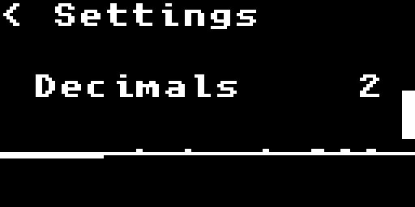

# ADR-010: progress

## Gate 1: what LVGL and TLS take (2026-11-17)

Run on the Pico 2 W through the probe. The Pico W's figures come from its builds and from the Pico 2 W's run-time figures. The owner: "Based on Pico 2W stats you SHOULD be able to compute the Pico W usage right? Performance is lesser a concern, the space does." The memory a library takes does not change with the chip: both are 32-bit, mbedTLS holds its numbers in 32-bit words on both, and the code and its configuration are the same.

The code is on branch `adr010_gate1`, not yet merged:
- **The measure build,** `-DADR010_MEASURE=ON` (`measure/`). It runs beside today's firmware and is driven from the console:
  - `lvgl` draws a settings page into a frame of its own, never sent to the panel;
  - `tls get <url>` fetches one file over HTTPS, in a task of its own, with every mbedTLS allocation counted.
  Nothing of it is built otherwise.
- **The local OTA server,** `tools/ota_server.py`. It serves a folder of releases in GitHub's layout; its main host redirects a download to an asset host, and the test certificate chains are of GitHub's two kinds.

### What was built

- **LVGL 9.6.0** (2026-09-16), a submodule, trimmed by `measure/lv_conf.h` to a 128 × 64 one-bit screen.
  - **On:** the label, button, list, bar and image widgets, the mono theme, flex layout, and the 8-pixel `unscii_8` font.
  - **Off, for the feature table:**
    - drawing in any colour format but one-bit (I1 and A8), and the complex drawing (rounded corners, shadows, masks);
    - the default and simple themes, the grid layout, and the Montserrat fonts;
    - observers, object IDs and property names, argument checks and the log;
    - the widgets animimg, arc, arclabel, buttonmatrix, calendar, canvas, chart, checkbox, dropdown, imagebutton, keyboard, led, line, menu, msgbox, roller, scale, slider, span, spinbox, spinner, switch, textarea, table, tabview, tileview and win.
  - **Its own heap** is 12 KB, static.
- **mbedTLS 3.6.6** (the SDK's), as a TLS 1.2 client (`measure/measure_mbedtls_config.h`):
  - ECDHE with ECDSA or RSA, and AES-GCM;
  - the curves P-256 and P-384, and RSA up to 4096 bits;
  - roots given as PEM;
  - a 16 KB input record and a 2 KB output one;
  - the NIST curves' fast reduction and the assembly multiply;
  - no clock, so certificates' dates are not checked.
- **The roots trusted:** the local server's two test roots, and GitHub's two:
  - USERTrust ECC, for `github.com`'s ECDSA chain (Sectigo);
  - ISRG Root X1, for its asset host `release-assets.githubusercontent.com`, whose RSA chain is Let's Encrypt's (YR1).

  Both chains were read 2026-11-17.
- **Optimisation:** LVGL and mbedTLS are compiled at -Os in every build, as `sha256.c` is already optimised for speed (ADR-004): this is third-party code nobody steps through. Our own code stays at the Debug build's -O0.

### Flash (`tools/size_report.py`, which now names LVGL and mbedTLS)

| Board, build | Today | With LVGL and TLS | LVGL | mbedTLS | Slot |
|---|---|---|---|---|---|
| Pico W, Debug (shipping) | 799.4 KB | **971.2 KB** | 86.6 KB | 69.8 KB | 1,016 KB |
| Pico W, Debug, the libraries at -O0 | 799.4 KB | 1,083.7 KB: over by 70,600 bytes | 189.4 KB | 79.8 KB (at -O2) | 1,016 KB |
| Pico W, MinSizeRel | 582.5 KB | 748.3 KB | 86.6 KB | 66.6 KB | 1,016 KB |
| Pico 2 W, Debug (shipping) | 775.5 KB | 939.8 KB | 83.2 KB | 65.8 KB | 1,792 KB |
| Pico 2 W, MinSizeRel | 580.0 KB | 739.6 KB | 83.2 KB | 62.6 KB | 1,792 KB |

- The mbedTLS column includes the 2.5 to 3.8 KB the image's SHA-256 already takes.
- The measure code and the roots as PEM add another 9 to 12 KB.
- **On the Pico W, u8g2 and MUI take 31.6 KB.** They go when LVGL replaces them, which leaves about 76 KB of the slot.

### RAM at link time

| Board, build | Today | With LVGL and TLS |
|---|---|---|
| Pico W, Debug | 223.9 KB | 243.8 KB of 256 KB |
| Pico W, MinSizeRel | 221.9 KB | 241.7 KB of 256 KB |
| Pico 2 W, Debug | 224.5 KB | 244.3 KB of 512 KB |

The added 19.9 KB is:
- LVGL's heap (12 KB) and its frame (1 KB);
- mbedTLS's contexts;
- the measure's own buffers.

On the Pico W, 12.2 KB is left for the C library's heap.

### At run time (measured on the Pico 2 W; the same on the Pico W)

- **The FreeRTOS heap** (112 KB) has 60,352 bytes free at rest on the Pico 2 W at 2.0.2. The Pico W had 59,216 free at rest at 1.20.194, its last reading, and 55,896 at its lowest in a soak with charges and two browsers.
- **LVGL,** a settings page of seven rows. It renders (; the colours in the picture are its palette, inverted).
  - **Its heap** held 7,636 bytes at most.
  - **Its task** has a 6 KB stack and used 4.0 KB of it at -Os. It took 6,480 bytes of the FreeRTOS heap.
  - **Speed:** a full frame in 7.1 ms at -Os and 36 ms at -O0; LVGL starts in 49 ms at -Os and 261 ms at -O0.
- **TLS,** one fetch through the main host's redirect to the asset host, with LVGL running:
  - **mbedTLS's peak** was 38,788 bytes with the local test chains and 40,740 with GitHub's. All of it was given back after each fetch.
  - **The fetch's task** has an 8 KB stack and used 2.2 KB of it.
  - **The FreeRTOS heap's low mark** fell from 53,872 bytes free to 5,376 with the local chains, and to **3,120 with GitHub's**. A fetch therefore takes 48.5 to 50.8 KB of it.
  - **Handshakes (the ECDSA chain, then the RSA chain):**
    - 148.4 s and 31.3 s with mbedTLS at -O0;
    - 19.8 s and 3.9 s at -Os without the NIST reduction and assembly multiply;
    - **3.3 s and 0.9 s** at -Os with them;
    - 7.6 s and 2.0 s in the Debug build with mbedTLS optimised;
    - 4.7 s and 1.1 s against GitHub itself, whose ECDSA chain is one certificate longer.
  - **The 795 KB update image** took 9.2 s over HTTPS at -Os, 15.7 s in the Debug build, and 0.96 s over plain HTTP.
- **GitHub was fetched once:** v2.0.2's manifest, 1,885 bytes, two hops. Every other fetch went to the local server (the owner's rule).

### The Pico W, computed

- **Flash fits** in the shipping Debug build, with the third-party libraries at -Os: 44.8 KB left, about 76 KB once u8g2 and MUI are gone. ADR-005's whole-image optimised build is not needed for this.
- **RAM does not fit as measured; it does with three trims.**
  - **As measured:** 59.2 KB free at rest, minus LVGL's task (6.5 KB) and a fetch from GitHub (50.8 KB), leaves about 2 KB at the fetch's peak with the unit at rest. Under a soak's load it is about 1.4 KB short, and the update job's 4 KB flash sector, held while it writes the free slot, comes on top.
  - **The trims,** each sized from a measured figure:
    - the fetch's task stack from 8 KB to 4 KB (2.2 KB used): 4 KB back;
    - LVGL's task in place of the menu's, whose 4 KB stack goes, with a 5 KB stack of its own (4.0 KB used): 5.5 KB back against the measure build;
    - only the roots the source needs, here GitHub's two: about 3.3 KB back. A plain-HTTP fetch, which still parses the four roots and seeds the random numbers, peaked at 8,392 bytes; the test roots are 1,839 of the four roots' 3,889 bytes of DER.
  - **With them,** about 14 KB is left at the fetch's peak at rest (1.9 + 4 + 5.5 + 3.3), and about 7 KB under a soak's load with the update's sector held. That margin is thin and computed, not measured: the poll's gate (5) measures it on the Pico W.
- **Speed is not measured on the Pico W.** Its Cortex-M0+ at 133 MHz multiplies slower than the M33, so its handshakes will take several times the Pico 2 W's. A background poll at start can wait that long.

### Found along the way

- **`sscanf` costs 30 KB.** newlib's brings its wide-character tables (`jp2uc`, `categories`). The measure code first used it to read an HTTP status line; firmware code should not use it.
- **mbedTLS at -O0 is unusable,** and its assembly multiply does not compile there ("impossible constraints"). Hence the -Os.
- **The local server stalled.** It did each TLS handshake inside `accept()`, on its one accepting thread. A unit flashed mid-handshake held that thread, and every later connection waited. Each handshake now runs in its request's own thread, with a timeout.
- **LVGL's mono theme pads for large screens:** one row fits in 64 pixels. The 12864's styles are our own (gate 3).
- **The console's line is shorter than a long URL,** so the measure fetches by short paths, which the server accepts under any owner and repository. The poll takes its addresses from a setting, not from the console.
- **The Pico 2 W is back on main's firmware,** 2.0.2-17 (the code of v2.0.2; the commits since are documents). Its settings are unchanged against the copy taken before (`logs/adr010/pico2w/before_gate1/`, `rc_run.py settings --compare`). The Pico W was not on the probe and still runs 2.0.2.
