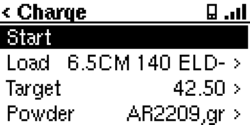
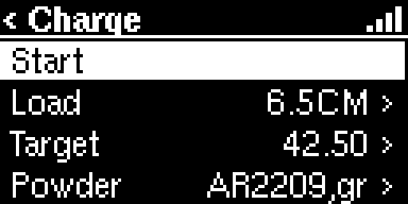
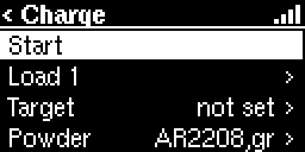
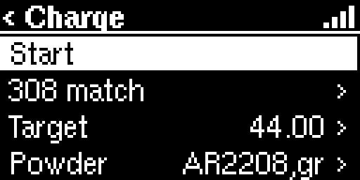
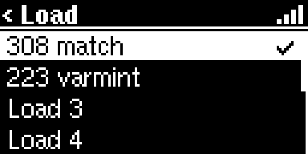
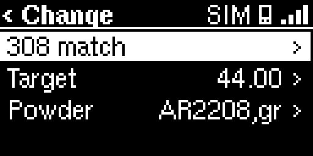

# ADR-014: progress

What was built and measured. The plan is in the [README](README.md).

## 2026-11-28, evening, later: "Load" and its name, at the owner's word

The owner tried the web's pages and the screen on the unit: "I like how web UI and front display is designed. The only comment is I'd keep the "Load" under the charge, and display maixmum number of X characters that doesn't overlaps with the key (load), and the right arrow showing this is a submenu." The fifth destination was not understood as asked; it is explained to the owner, its answer still open.

### What changed (`27d35c7`)

- **The Charge page's row is "Load" and the name,** with ">" (`menu_nav.c`: the row's label "Load", the name its value; `choice_title`, made for the name as the row, is gone, the choice's page titled by the row's label as before).
- **A chosen name is cut short of its key** (`menu_view_12864.c`): a choice row's value, marked in the screen model (`row_name`), is cut at a whole character to fit 3 px after its label, with no space left at its end; the label is whole. Every choice row takes it (a powder's name beside "Powder" too). Any other value is laid out as before, its label clipped as the safety net: a number is never cut, since a cut figure is a false one. The console's `screen` still gives the whole name.
- **The mock** (`tools/ui_mock/charge_profiles_12864.py`) cuts the name by the same sum; the sheet's "Load" row draws it, "6.5CM 140 ELD-".
- The skill `embedded-ui-design` (rule 9) and `menu_design.md` say so, with the owner's words.

### Measured

| Check | Result |
|---|---|
| `build_pico_w.ps1` | links. RAM at link time 36 bytes more (the mark per row) |
| `flash` | `VERDICT PASS`: 2.0.3-395 at `27d35c7` |
| `snap`, Load 1 named "6.5CM 140 ELD-M" live | "Load 6.5CM 140 ELD- >", as the mock; the name put back by `POST /api/v1/charge_profiles/revert` |
| `menu_tour --compare tests/menu_baseline/pico_w`, the inversion off live | every judged page as its baseline but two: Charge, changed as meant, and Settings › Calibration › Powder, whose list opens on the powder in use. The owner, trying the unit, stored Load 1 as "6.5CM" at 42.50 on AR2209: both pages show it. Both saved again from this tour. (A first tour also differed on the main page: it began with the screen left on the Charge page by the snap) |

| The longest name, cut | Load 1 as the owner stored it |
|---|---|
|  |  |

**These two pages of the baseline follow the stored load:** a tour after Load 1 is changed again, or another load chosen, differs on them, as the Charge page has since the target was stored.

## 2026-11-28, evening: the web's part, a mock for the owner

Taken over from the parked session at the owner's word. The bench open again, the hopper empty ("Open, hopper empty"). Built in `ba863a8`, on the stand-in first, then put on the Pico W.

### What was built

- **The Trickler:** a Load row above Powder and Target in the charge's card. Each is written into the chosen load and stored at once (`PATCH /api/v1/charge`, then `POST /api/v1/charge_profiles/save`), as the screen stores at its confirm: the page leaves nothing changed and not stored. The target is stored when it is typed and left, or 0.8 s after the last press of its keys, so a run of presses is one store. Start stores a target not yet stored, then starts the load shown (`{"charge_profile": n}`). While a charge runs the load is locked with the powder and the target.
- **Loads, a fifth destination** between Trickler and Powders, a cartridge for its icon. The eight, each with its target and powder under its name, "In use" on the chosen, "Not stored" on one changed. Each opens its form drawn from the schema; its powder is a choice by name (`hooks.choices` in `form.js`, the powders' names given by the page). Store and Undo act on the eight and the choice. It follows another client's write (a setting's event) and another load chosen (the stream's state: a choice is no event).
- **The charge's card made compact:** its rows lost the padding and rules the form's style gave them, and go to 48 px at a height of 640 or less (rule 2's least; they are set before a charge, never worked during one). On main the Trickler sat on its 500 px floor at 375 x 553 and scrolled by 11 px; with the third row it fits, the figure's room 79 px, the floor now 482.
- **The loads' two help lines** named API paths ("settings/charge decimal_places", "GET /api/v1/powder_profiles"), which no other field on the pages does: reworded in the settings' table.
- **The stand-in** (`tests/web_test.py`): recorded from the Pico W, on 2.0.3-390 and again on 2.0.3-393; taught the loads (the charge as the chosen load, the choice stored and undone with the eight, the list's `saved`, `charge_profile` in the started events), and a write refused while a throw or a job runs, by the schema's `refused_while`, in the unit's words. It refused none before, for any resource.
- `features.md` rows N10 and N11; `features_check.py --final` passes.

### Measured

| Check | Result |
|---|---|
| The portal | 44.9 KB gzipped, 43.1 before |
| `build_pico_w.ps1` | links. Flash 935.0 KB of 1,016 (933.2 at `4043b28`); RAM at link time 252.9 KB, unchanged |
| The stand-in, 375 x 553 | no scroll; three presses of + one store; a load with no target, "Give a target first."; a charge of Load 2 at 44.00, `charge_profile` 1 in both started events; a write to the load in use during the throw refused under its field, "the charge profile in use is refused while a throw is under way"; the list's tags followed each write |
| The stand-in, 390 x 664, 768 x 1024 dark, 1280 x 800 | looked at: the wide window opens the load in use beside the list; nothing collides; no console error but the 409 asked for |
| `settings --save logs/adr014/picow_before_web`, then `flash` | `VERDICT PASS`: 2.0.3-393 at `ba863a8` |
| `settings --compare` with that copy | `VERDICT PASS`: the 25 resources unchanged |
| The unit's own pages, 390 x 664 | the Trickler with its Load row, the Loads page: read, no console error. Nothing written |

### For the owner, at the mock

1. **A fifth destination** (the owner's rule of 2026-11-18 was four). Recommended: Loads beside Powders, as built: a person looks for loads by their name. The other way keeps four, a Loads | Powders switch at the top of the Powders page, and hides the loads under a word that is not theirs.
2. **The Trickler stores each change** of the load, its powder and its target (the README's "The page stores what it changes"). A store is two writes of the block (the spare slot, then its place); a run of presses is one.

### Left

1. The owner's look at the mock (the stand-in, or the unit at 192.168.2.100). Then on the unit: a target set from the Trickler there after a restart (the README's check), and the usual proof.
2. The Pico 2 W's baseline, the v1.21 update, the README and the manuals, the close and the PR, as below.

## 2026-11-28, early afternoon: parked by the owner

The owner: "Can you write down the progress and park the action for now? And perhaps leave for later implementation this afternoon." Nothing runs: the build's session is idle, the unit is left as below ("How the unit was left"), and the branch `adr014_charge_profiles` holds the work in this checkout, not pushed.

**The EEPROM's size, answered by the owner:** "So yes this MIGHT be my home build, for which ran 128Kbit EEPROM. The production units on Pico 2W should be 256Kbit so we don't need to worry that much rightn ow, but in the future." So the bench's Pico W is very likely the board the README could not try, and nothing more is built for the smaller chip here. What it leaves behind, where a later ADR meets it: 15 KB kept empty for good and the slots left on such a chip (`eeprom.h`, AGENTS.md), and the unit's own `eeprom_kb`. The chip's marking is still not read; reading it would make "very likely" certain, and nothing waits on it.

**Checked by the session that started the build's,** beside the build's own report: the whole diff read; `host_test.py` and `module_graph.py` run again, `VERDICT PASS` each; the unit read over the network (2.0.3-390 at `4043b28`, `eeprom_kb` 16, "Load 1" chosen, no target, the loads stored); the bench sessions' verdicts in `logs/rc` and the cup's ledger read; the three screens looked at against the mock. The bench's checks and the two firmware builds were not run a second time.

### Left

The ADR is Open until each is done; the park itself ends at the owner's word.

1. **The web's part:** a mock on the stand-in for the owner to click through, then the Trickler page's picker and the Loads page, the page storing what it changes. Until then a target typed on the Trickler page is written live and not stored, and the stand-in has no `/api/v1/charge_profiles/save`, which the page's powder choice now posts. The stand-in's recording comes with it (`tests/web_test.py --record`).
2. **The Pico 2 W:** its baseline's Charge page saved again, with the unit on the probe (`menu_tour` now judges that page).
3. **A unit on v1.21 updated to this:** it rewrites the unit's settings, so it waits for the owner's word.
4. **The choices the README did not settle** (below): each is as built until the owner says otherwise. None was objected to when reported.
5. **The README and the manuals** where they show the Charge page; then the close (this file, the README, the index) and the PR.

## 2026-11-28, later: proven on the Pico W

The owner opened the bench for one unit: "A pico w unit is connected, but no powder in the hopper for your disposal." The Pico W on the probe (opentrickler-4A82, unit 4A821948, 192.168.2.100, on 2.0.3-374 before), its scale reading 0.00, the hopper empty. Every run that turned a motor went through `rc_run.py`'s cup check: 0.00 gr before and after each. The Pico 2 W was not touched.

### What the unit found that the PC could not

**`GET /api/v1` was cut off.** `api_check` failed at its first read: "HTTP: a streamed reply overflowed its chunk; it is cut off". The index's guide is one item of the index's stream and must fit a chunk, 1,526 bytes; ADR-014's words had taken it from 1,387 to 1,521 characters, past the chunk with its quotes and the 14 bytes after it. Every client that works from the unit's own description reads the index first (`unit_api.py`; the portal's Settings page takes the unit's paths from it), on every unit. Fixed in `4043b28`: the guide is 1,463 characters, and a static assert in `api_v1.c` fails the build when it no longer fits. The schema's longest item is 1,097 bytes (the charge's start), read on the unit.

### The EEPROM's size: this unit says 16 KB

`stats` on the console ends `eeprom_kb=16`, and `GET /api/v1/debug` gives `"eeprom_kb":16`. 32 was expected: the README has the owner's "I don't have the 128kbit board".

- **What the answer rests on:** the 64 bytes read at 17 KB are the 64 read at 1 KB, where the scale's record lies.
- **Why it is probably the chip:** no build's map puts a copy of the scale's record at 17 KB. ADR-009's first build kept a powder's calibration there, another struct. On a 256 kbit chip that never ran that build, 17 KB is blank.
- **Not verified by a second means.** The chip's marking would settle it at a glance; so would a read of every page against its twin 16 KB above, which no command does today.
- **If it is so,** this is the board the README could not try: the spare slot at 31 KB has lain at 15 KB on this unit since ADR-017, every save written there first, and 15 KB kept empty for good is then proven by this unit's own saves.

### The checks, in order

| Check | Verdict |
|---|---|
| `settings --save logs/adr014/picow_before`, before the flash | 17 resources of 2.0.3-374 kept |
| `flash` (2.0.3-389 at `ec21c95`; again 2.0.3-390 at `4043b28` after the guide's fix) | `VERDICT PASS`. At its first start: "Config: 0x1800 never written: its defaults stored" |
| `settings --compare` with that copy | every field of the 17 unchanged; the eight charge profiles new, as meant ("Load 1" to "Load 8", no target, each on powder 0, the powder the unit had chosen) |
| `menu_tour --compare tests/menu_baseline/pico_w`, the inversion off live | `VERDICT PASS`: every judged page as its baseline. The Charge page differed, as meant |
| `reach` | `VERDICT PASS`: the Charge page's four rows, the load's choice page (eight rows and its title), the target's editor, Change's three rows |
| `charge_cycle` | `VERDICT PASS`: 30.000 for a target of 30.000 |
| `settings_roundtrip` | `VERDICT PASS`: 25 resources, 204 fields written back unchanged, 205 values outside their limits refused |
| `api_check`, the local OTA server up without its name | `VERDICT PASS` on `4043b28`: 75 paths, 47 of the schema's 47 actions called, 99 routes, none unlisted. The server was stopped after |

`reach`, `charge_cycle` and `settings_roundtrip` ran on `ec21c95`; `4043b28` differs from it by the guide's words alone. `rc_run.py`'s changes ran as written: `api_check` with `charge_profile`, and each command's revert after its charge.

### The ADR's own checks

- **Two charge profiles on one powder throw two weights.** One simulated charge, "Load 1" at 20 and "Load 2" at 10, both on powder 0, the load changed between throws by `PATCH /api/v1/charge`: throw 2 ended at 20, throw 3 at 10, each `started` carrying its `charge_profile`, its `target` and the same `powder_profile`.
- **A change to the powder's gains shows in both.** `fine_kp` of powder 0 from 2 to 1.5 between throws: the console's "throw 4 on fine kp 1.5000" on "Load 2" and "throw 5 on fine kp 1.5000" on "Load 1". The tuner began afresh at each change of target, as the README says it does.
- **During a throw:** a write to the chosen profile 409, to another 200, a choice 409.
- **The weight is there after a restart.** 44.00 set at the screen by presses on "308 match"; 41.5 set by `PATCH /api/v1/charge_profiles/1` and saved on "223 varmint"; "223 varmint" chosen at the screen. After `rc_run.py reset`: `charge_profile` 1, its target 41.5; `charge_profiles/0` at 44; both names; `saved` true.
- **The EEPROM's size** on the console and in `GET /api/v1/debug`: above.

### The screens, on the unit

Seen against the mock's third row: the name is the row, the page is titled Load, Change has the same three rows.

| Charge, a unit just updated | Charge, a load named | Load | Change, between throws |
|---|---|---|---|
|  |  |  |  |

The Pico W's baseline of the Charge page was saved again (`tests/menu_baseline/pico_w/page_charge.png`). `menu_tour` now judges that page: its target is stored, where it "lives in RAM until ADR-014". The choice's page has no id of its own and is no page of the tour.

### How the unit was left

Running 2.0.3-390 at `4043b28`, a debug build, flashed by the probe. Its 25 resources all stored: the 17 from before the flash unchanged field for field, the eight charge profiles at their defaults, "Load 1" chosen, no target. Nothing live that is not stored: the test loads' names and targets were written back and saved, the display's inversion and the powder's gain reverted, the simulated scale off. Reset once at the end, idle at the main menu. The local OTA server is stopped; the unit's update source is as stored (this PC's), so its poll at a start fails for want of it, as it did before.

### Still open after the unit

- **The Pico 2 W:** not flashed. Its baseline's Charge page will differ, and `menu_tour` now judges it: to be saved again with the unit on the probe.
- **A unit on v1.21 updated to this,** a soak, `pulses`: not this session's.
- **The EEPROM's size on this board,** to be settled by the chip's marking.

## 2026-11-28: the firmware, built and proven on the PC

Built on the branch `adr014_charge_profiles`, from main at 391a90e, by a session of its own in the owner's checkout. When this part was written nothing had been proven on a unit: the owner had not said the bench was ready. Every figure in it is from the PC; the unit's proof came later the same day, above.

### What was built

**The module, `src/services/charge_profiles`:**
- **`charge_profiles.c`, the record.** `charge_profile_t` (24 bytes: `name[16]`, `target`, `powder_profile`, `unused[3]`) and `eeprom_charge_profile_data_t` (196 bytes: `zero`, `chosen`, the eight), as the README lays them out, in the slot at 6 KB (`EEPROM_CHARGE_PROFILES_BASE_ADDR`, the name `EEPROM_APP_CONFIG_BASE_ADDR` had and no code used). Loaded by `load_config_layout` with the header-and-array layout. It needs the storage alone, so the PC build runs it.
- **Its defaults** are made at the load, on the stack: "Load 1" to "Load 8", no target, each on the powders' stored choice, the first chosen.
- **What is mended in RAM, not stored:** a chosen index past the eight and a powder's id past the powders run as the first (the README). Two more of the same kind, found while writing the load: a target that is no weight (not a number, or below 0) is not set, since a start compares it with 0 and would have thrown it; and a name with no ending is ended, so a name in RAM is always a string.
- **`charge_profiles_settings.c`, the settings' table** (`/api/v1/charge_profiles/{id}`: `name`, `target` nullable, `powder_profile`; its save and its revert) and the three writes the charge, the screen and the API share: `charge_profiles_choose`, `charge_profiles_set_target`, `charge_profiles_set_powder`. The last two go through the table, so a target set at the screen, by `PATCH /api/v1/charge` or by a start takes the same checks, the same refusal during a throw, and gives the same `setting changed` event.
- **A target must be one the digits show.** The charge knows the decimals and the charge profiles lie below it, so the charge hands its check over at its start (`charge_profiles_set_target_check`).

**The powders (`services/profile`).** The powder in use is a variable in RAM, set by `profile_select`, which the charge profiles call at the start and at each choice. `current_profile_idx` is read once more (`profile_get_stored_choice`, for the defaults above) and written by nothing. `profile_get_selected()` and `profile_get_selected_idx()` are as they were for their callers.

**The settings (`services/settings`).** A resource may name `revert_rest`: what its block holds beside its parts. A revert put back the eight parts and not the header, so "the eight and the choice, one block" needed it. The powders' revert had the same gap for their choice.

**The charge (`services/charge`):**
- The target is `charge_profiles_target()`. The five digits in RAM, their writer and `charge_mode_set_target` are gone; the editor's own digits are the menu's.
- **Each throw takes its target and powder as it begins,** under the lock they are written under. Main wrote a new target into the running charge at the write; the next throw throws the same weight either way.
- **A change of decimal places** checks all eight targets and names the one in the way: "308 match: its target cannot be shown at those decimals; set one that can be first".
- **A start** takes `charge_profile` beside `target` and `powder_profile`. It is refused (`no_target`) when the profile it would throw has no target the digits show.

**The API and the events (`web/api`, `services/events`):** `GET /api/v1/charge_profiles`; `charge_profile` and `charge_profile_name` in `GET /api/v1/charge`; `charge_profile` in the PATCH and the start; `charge_profile` in a charge's and a throw's `started`, carried in the event's `result`, which those kinds did not use. The index, the guide and the schema's actions and events say so. The settings' own routes, the export and the schema follow from the table.

**The screen (`ui/menu`):** the Charge page is Start, the chosen load's name as a row, Target, Powder; the name's row opens a choice page titled "Load" (a row may name its choice page's title, `choice_title`). Change, between throws, is the same three rows. A load chosen, a target set and a powder chosen are each stored at the confirm. "Faults at the start" names the record "Loads". The console's `screen` describes the row and the page as any list's.

**The EEPROM's size (`services/storage`):** `config_eeprom_kb()` reads 64 bytes at 1 KB (the scale's record) and at 17 KB: the same, a chip of 16 KB; different, 32; a blank page at 1 KB, or a chip that does not answer, 0, not told. Read once and kept. On the console's `stats` (`eeprom_kb=`) and in `GET /api/v1/debug`.

**Housekeeping:** the update's reset list (`charge_profiles`, appended); `eeprom.h`'s map, with 15 KB kept empty for good; `rc_run.py`; the Trickler page's powder choice, which now stores the charge profiles.

### Choices the README did not settle

Each is as built, and the owner's to change.

1. **A throw that would begin with no target ends the charge on a fault, "No target".** It is reached by choosing, between throws, a load whose target is not set. The README says a start with no target is refused and that the unit never throws a weight nobody set; it does not say what a running charge does. The other answer would be to refuse the choice while a charge runs.
2. **The two further mendings** above (a target that is no weight; a name with no ending).
3. **The target's row says "not set" and gives no unit,** as today's screen does. The mock's sheet drew "Not set" and "44.00 gr"; neither was among the owner's choices at it.
4. **A choice's refusal is wrapped onto the message's three lines** at the screen, where it was one line cut at the panel's edge: without it the decimals' refusal showed the load's name and little else. It holds for every choice's refusal.
5. **Choosing a charge profile gives no event of its own.** The stream's state message follows it, as it followed the powder's choice. A target or a powder written by `PATCH /api/v1/charge` or by a start now gives a `setting changed` for `charge_profiles/{id}`, where a target gave none.
6. **The Trickler page stores its powder choice and no more.** A target given at its Start is written into the chosen load live, as the README's table says of a start, and is not stored: the picker and the page's stores are the web's part of this ADR.

### Two things a copy of the settings does not do

- **It does not hold which load is chosen.** The export gives each resource's fields, and the choice is no field of the eight: it lies in their block's header, as the powders' choice did in theirs. A restore leaves the choice as the unit has it.
- **A restore across a change of decimal places can need two passes.** The decimals are refused while a stored target cannot be shown at them, and the targets are refused while the decimals cannot show them. With one target in RAM this could not last past a restart; with eight stored it can. The import writes each resource in the export's order (the charge's settings before the loads), says which it could not write, and a second restore then goes through.

### What an update to this version shows

A unit updated over Wi-Fi finds the slot at 6 KB blank on its trial, so the record is held as its defaults and the `update confirmed` event names `charge_profiles` among the settings reset. That is the loader's rule for a new record's slot (ADR-017), not a setting lost.

### Measured on the PC

| Check | Verdict |
|---|---|
| `build_pico_w.ps1` | links. Flash 933.3 KB of 1,016 (927.3 before: 6.0 KB more; 933.2 at `4043b28`); RAM at link time 252.9 KB of 256 (252.6 before: 0.3 KB more). The module is 3.2 KB of the flash |
| `build_pico_2w.ps1` | links. Flash 919.7 KB of 1,792 (919.6 at `4043b28`); RAM at link time 285.9 KB of 512 |
| `tests/host_test.py` | `VERDICT PASS`, the new cases in it (below) |
| `tools/module_graph.py` | `VERDICT PASS`: nothing goes up, no loop |
| `tests/release_records.py --elf build_w/app.elf --elf build/app.elf` | `VERDICT PASS`: `charge_profile_t` 24 bytes and `eeprom_charge_profile_data_t` 196, new since v1.21, found by their use, laid out the same in both images |
| `tests/calibration_sim.py`, `tests/step2_sim.py` | `VERDICT PASS` each (what they load was not touched) |
| `tests/features_check.py --final` | passes |

**The host test's new cases** (`tests/host/config_migration_test.c`, by the module's own load over the EEPROM in RAM):
- the record's sizes and offsets as the README lays them out;
- a blank slot: "Load 1" to "Load 8", no target, each on the powder given, the first chosen, stored, nothing said; the next start reads it, and the powders' choice is then taken for nothing;
- the powders' stored choice out of range: each on the first powder;
- a record with longer profiles (a later version's, 8 bytes appended to each): this version's fields read, the choice too, stored at this size;
- a chosen index of 9: the first runs, the eight as stored, the chip's slot unchanged, not saved;
- a powder's id of 200, a target that is not a number, one below 0, a name with no ending: each mended in RAM, the slot unchanged, not saved; stored once the person saves;
- a damaged record: the defaults, no target set, the slot unchanged, and it is said;
- the EEPROM's size: not told on a blank chip; 16 KB where 17 KB reads what lies at 1 KB, nothing written. The 32 KB answer is every bench unit's own and was not made on the PC.

### Not done, not verified

*As this part stood before the unit's proof; what the unit then settled is above.*

- **The unit's proof, all of it:** two loads on one powder throwing two weights; the weight there after a power cycle; a v1.21 unit updated to this; `menu_tour`, `reach`, `api_check`, `settings_roundtrip`; the EEPROM's size read on a real chip. The screen was built to the mock's third row and has not been seen on a panel.
- **`rc_run.py`'s changes were not run:** they need a unit. `api_check` sends `charge_profile` in the charge's PATCH and start, expects it in the `started` event, and where the chosen load has no stored target writes one live and reverts it. Each command that starts a charge with a target (`charge_cycle`, `soak`, `reach`, `charge_fault`, `settings_roundtrip`, `update --expect busy`) puts back what is stored after it (`setting charge_profiles/0 revert`), since a start now writes the target into a stored resource and would otherwise leave the unit's settings differing from their copy.
- **The menu baselines:** the Charge page gains a row on both units. Not saved.
- **The portal's new pages, the stand-in's recording, the README and the manuals, the ADR's close and its PR:** left to the session that started this one. Until the stand-in is recorded again it does not have `/api/v1/charge_profiles/save`, which the Trickler page's powder choice now posts.
