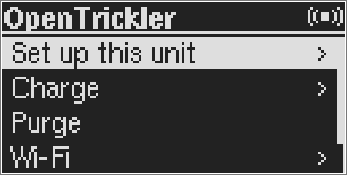
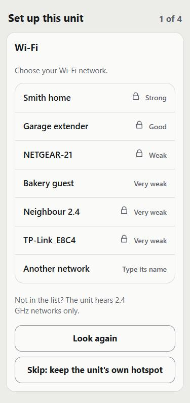
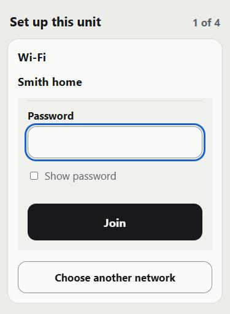
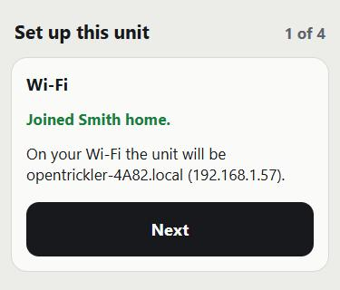
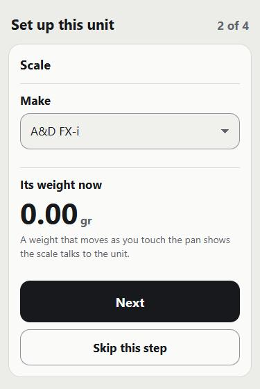
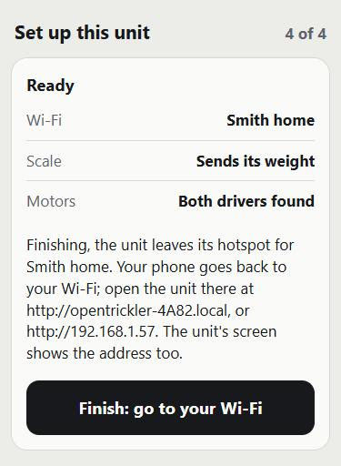
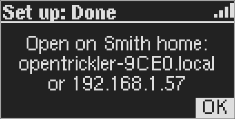
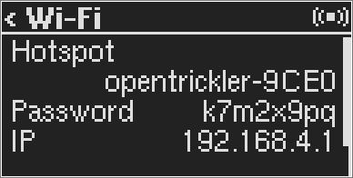

# OpenTrickler Wireless

The OpenTrickler joins your Wi-Fi so that you can use it from a phone, a tablet or a computer, and so that it can find firmware updates. It joins 2.4 GHz networks only: the Pico's radio has no 5 GHz.

A new unit, or one after a factory reset, starts as its own Wi-Fi hotspot, named `opentrickler-` and four characters made from its Pico's unique id. Each unit has its own password, which never changes. The set-up runs on your phone's browser, and the unit's screen follows each step.

## The green LED

The Pico's own green LED shows the Wi-Fi, which helps on a unit with no screen:
- **Solid:** joined to your Wi-Fi.
- **Slow flashing** (one second on, one second off): the unit is its own hotspot, waiting for you to connect it.
- **Fast flickering:** starting up, or joining.

## With a phone

1. On the unit's main menu, choose **Set up this unit**. The unit shows a code.

   
   

2. Scan the code with your phone's camera and join the network it offers. The set-up page opens by itself. If it does not, open `http://192.168.4.1` in the phone's browser.
3. **Choose your Wi-Fi** from the list, strongest first. A network that is not listed may be 5 GHz only; **Another network** lets you type a hidden network's name.

   

4. **Type its password** and press **Join**. The phone and the unit's screen both count the seconds while it joins (up to 30).

   

5. Once it has joined, the page shows the address the unit will have on your Wi-Fi. Press **Next**.

   

6. **The scale:** choose its make. Its weight shows live, so you can see that the scale talks to the unit. **The motors:** the page shows whether each driver was found. You can skip either step and come back to it in **Settings**.

   

7. **Finish.** The unit leaves its hotspot and stays on your Wi-Fi, and your phone goes back to your own network. The unit's screen shows where to find it: `http://opentrickler-XXXX.local`, or its IP address.

   
   

If you choose **Skip: keep the unit's own hotspot**, the unit stays its own hotspot. Its page is then at `http://192.168.4.1` from a phone or computer joined to that hotspot.

## With a computer, or without the code

The unit's **Wi-Fi** page shows its hotspot's name and password. Join that network from any computer, tablet or phone, using that password, then open `http://192.168.4.1`. The same set-up opens.

## Afterwards

- **Find the unit:** its **Wi-Fi** page shows its name (`opentrickler-XXXX.local`) and its IP address. Open either in a browser on the same network.
- **If your Wi-Fi is away,** the unit tries it again every minute. It does not forget it.
- **Another network:** change it in the web page's **Settings › Wi-Fi**. A factory reset (**Settings › Factory reset** on the unit, or the web page's **Unit** page) clears every setting and starts the set-up again.
