# OpenTrickler Powder Analysis

*English | [Deutsch](powder_analysis_de.md)*

The powder analysis finds the profile values for a new powder automatically. You enter the target weight and describe the powder, the OpenTrickler makes a series of throws and ends with a tested set of values that you can save as a profile.

## What it does

A profile tells the tricklers how fast to run (Kp) and how hard to brake near the stop point (Kd). Finding these values by hand means guessing, throwing, watching and adjusting, many times over. The analysis does this for you:

1. It finds the coarse trickler values (Kp and Kd).
2. It finds the fine trickler Kp. The fine Kd is taken from a built-in table; it has almost no effect on this firmware and is therefore not searched.
3. It checks the result with a round of 10 throws. At least 9 of them must hit the target.
4. It measures how much powder still falls after the fine trickler stops and recommends a matching **Fine Trickler Stop Threshold**.

Everything else stays as it is: the analysis reads your charge mode settings but never changes them. Profiles are only written when you press **Save** at the end.

## Before you start

- **Fine Trickler Stop Threshold** (charge mode settings): use a value *between* two scale steps, for example **0.03** or **0.05**, not 0.02 or 0.04. With a value on an exact step the scale rounding decides whether a throw stops one step early or only at the target. The analysis warns you on the display and on the web page if your setting is on an exact step.
- **Coarse Trickler Stop Threshold**: for example 3 gr. The coarse trickler stops this far below the target, the fine trickler finishes the throw.
- Have a **free profile slot** or one you are willing to overwrite. The result is saved under the name `analysis_1`, `analysis_2`, ... (on the web page you can type any name, up to 15 characters).
- Fill the hopper well. The analysis makes about **20 to 30 throws** and takes **15 to 25 minutes** including emptying the pan.
- Use the pan you normally use. You empty it into the hopper after every throw, so no powder is lost.

## How the analysis runs

The analysis is a sequence of throws. You start it, fill the trickler tubes once, and then repeat the same two steps until it is finished:

1. The OpenTrickler throws into the pan.
2. You empty the pan into the hopper and put it back. When the scale is stable at zero, the next throw starts by itself.

You can do this from the display or from the web page; both show the same run and both can control it. The phases, in plain words:

| Phase | What happens | Throws |
|---|---|---|
| Coarse Kp | Only the coarse trickler runs. The analysis looks for the smallest Kp that still reaches the coarse stop point fast enough (within about 8 s). | 4 to 8 |
| Coarse Kd | The brake of the coarse trickler is tried with a few values. The fastest one that keeps the coarse phase within 10 s wins. | 2 to 6 |
| Fine Kp | Full throws. The analysis looks for the smallest fine Kp whose throw finishes within 13 s. A slow fine trickler drops less powder after the stop, so this is the most precise setting that is still fast enough. | 3 to 6 |
| Verify | A round of 10 throws with the found values. 9 hits are needed. If 2 throws in a round overthrow, the round is given up, fine Kp (−10 %) or the fine minimum speed (−25 %) is lowered and a new round starts (at most 3 corrections). | 10 to 40 |

A **hit** is a throw within the fine threshold of the target that finished within 15 s. The analysis stops after 60 throws at the latest and then shows the best values it found.

## Using the display

Start from the main menu: turn the knob to **Powder Analysis** (after Cleanup), press it, put the pan on the scale and press **Next**.

Operation is the same on every screen: **turn the knob** to move the cursor (to a digit, a list entry or one of the two buttons at the bottom) and **press the knob** to confirm. The **reset button** usually goes back or, while the analysis is running, asks whether to abort (on the result pages it moves on, on the last one it discards). On the empty-pan screens there is no cursor: pressing the knob pauses, the reset button aborts.

### Target weight

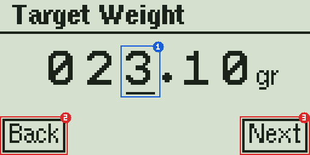

The last charge weight is filled in. Turn the knob to change the digit under the cursor **(1)**, press the encoder button to move to the next digit. After the last digit the cursor moves to **Next (3)**; press again to continue. Turn left to go back to the digits. The reset button is **Back (2)** and leaves the analysis.

### Powder shape and grain size

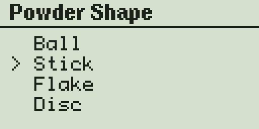

Select the shape of the kernels (Ball, Stick, Flake, Disc) and then the grain size (Fine, Medium, Coarse). These two choices select the start values of the search. They do not have to be exact; the search corrects them.

### Prepare

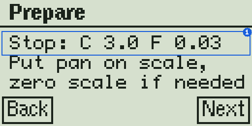

The first row **(1)** shows the stop thresholds of your charge mode settings (C = coarse, F = fine). Put the pan on the scale and zero the scale if needed, then press **Next**.

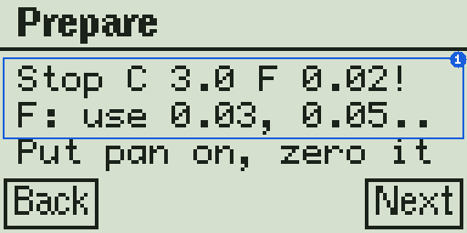

If the fine threshold is on an exact scale step, the row ends with **!** and a tip shows the values that work **(1)**. You can continue, but the verification will probably fail. Better: go back, change the threshold in the charge mode settings and start again.

### Flooding

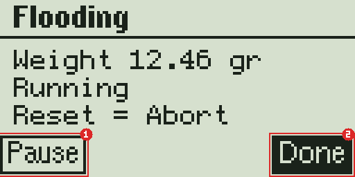

Both tricklers run so that the tubes fill up. **Start / Pause (1)** toggles the motors, **Done (2)** ends the flooding when powder comes out of both tubes evenly. The reset button aborts the analysis.

### Empty the pan

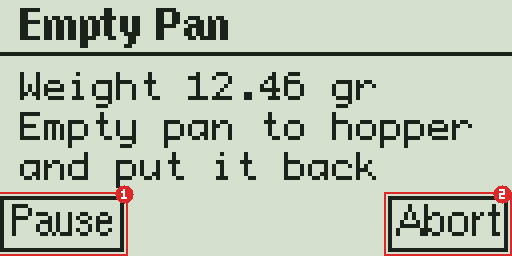

Pour the powder back into the hopper and put the pan back. The next throw starts as soon as the scale is stable at zero. **Pause (1)** pauses between throws (for example to refill the hopper), **Abort (2)** asks whether you want to stop the analysis.

### Throw running

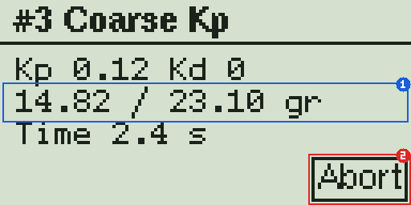

The title shows the throw number and the phase. The second row **(1)** shows the current weight against the target of this throw, the third row the time since the throw started. **Abort (2)** stops the motors at once and asks for confirmation.

### Throw result

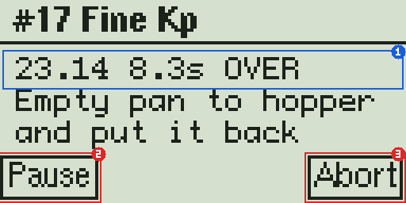

After every throw the first row **(1)** shows what happened: final weight, duration and the evaluation (for example `OVER`, `UNDER`, `HIT`, `OK`, `SLOW`, `TIMEOUT`). Then empty the pan as before. **Pause (2)** and **Abort (3)** work as on the empty-pan screen.

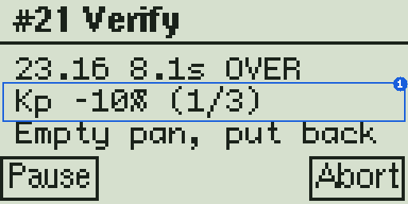

When a verification round was given up, the second row **(1)** shows the correction that was made (`Kp -10%` or `MinSpd -25%`) and how many corrections have been used (here 1 of 3).

### Paused

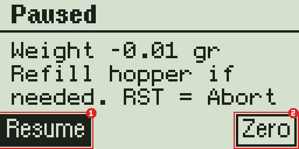

While paused you can refill the hopper. **Resume (1)** continues; the next throw starts once the pan is back and the scale is stable at zero. **Zero (2)** zeroes the scale (only shown when your scale driver supports it). Use it only with an empty pan on the scale. The reset button aborts.

### Abort

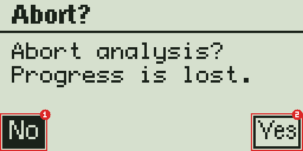

**No (1)** returns to where you were, **Yes (2)** ends the analysis. The values found so far are lost.

### Result 1/3: coarse trickler

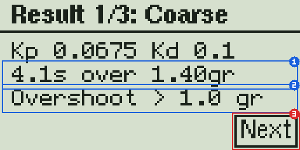

Kp and Kd of the coarse trickler. Row **(1)** shows the coarse time and how far the coarse throw went over the coarse stop point. Row **(2)** is a check: `OK`, or a note such as `Overshoot > 1.0 gr`, `Slower than 10 s` or `Coarse Kd too slow`. A note means the coarse trickler does not meet the goal with this powder; the values are still usable. **Next (3)** continues.

### Result 2/3: fine trickler

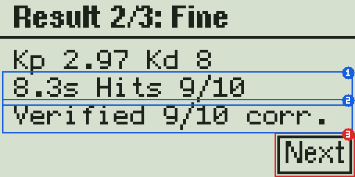

Kp and Kd of the fine trickler, the total time of a throw and the hits of the best verification round **(1)**. Row **(2)** is the outcome: `Verified 9/10` (or `10/10`, with `corr.` if a correction was needed), `Not verified`, `Overthrows, 3 corr.` or `Trial limit reached`. **Next (3)** continues.

### Result 3/3: threshold

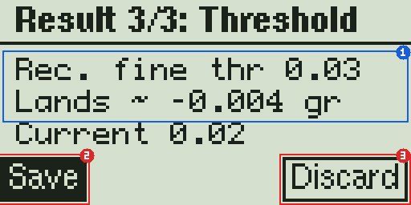

The analysis measured how much powder fell after the fine trickler stopped and derives a recommended **Fine Trickler Stop Threshold (1)**: `Rec. fine thr 0.03` is the recommended value, `Lands ~ -0.004 gr` is where throws will land on average with that value, `Current 0.02` is your current setting. Change the setting in the charge mode settings afterwards if you want to use the recommendation; the analysis does not change it.

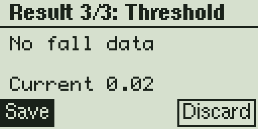

`No fall data` appears when no full throw could be measured.

**Save (2)** stores the values in a profile slot, **Discard (3)** (also the reset button) leaves without saving.

### Save to a profile slot

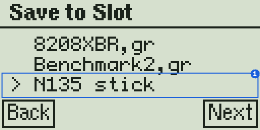

Turn the knob to the slot you want to overwrite **(1)** and press the encoder button. The reset button goes back.

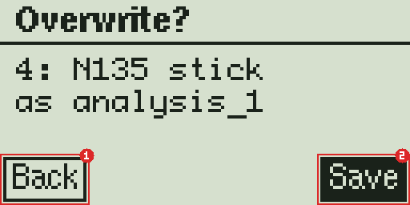

The slot and the new name are shown once more. **Back (1)** returns to the list, **Save (2)** writes the profile.

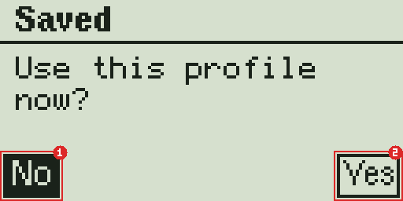

Finally you can make the new profile the active one: **Yes (2)** selects it, **No (1)** keeps your current profile. Both return to the main menu.

## Using the web page

Open the web portal of the OpenTrickler and press **Open Powder Analysis** at the bottom of the Trickler tab, or open `http://<address of your OpenTrickler>/powder_analysis` directly. The page works on a phone as well as on a computer. The buttons at the bottom lead back to the portal.

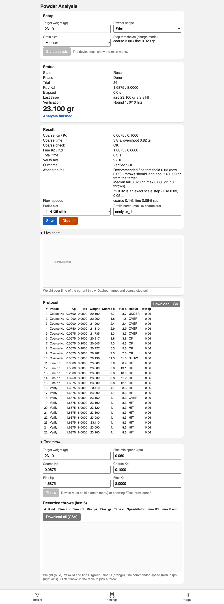

### Setup and start

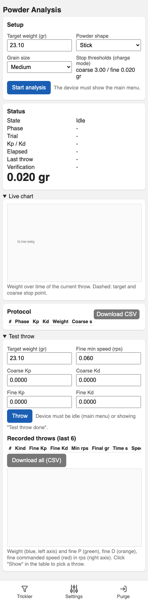

Enter the target weight, the powder shape and the grain size and press **Start analysis**. The OpenTrickler must show its main menu for this; it then skips the display setup screens and goes straight to *Prepare*. The stop thresholds of the charge mode are shown for a check; the result section warns if the fine threshold is on an exact scale step.

### Status

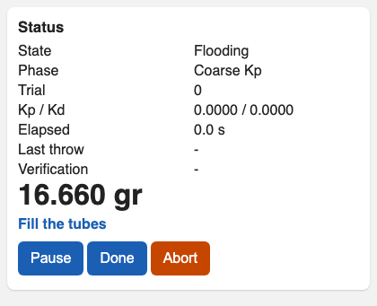

The status section shows the state, the phase, the running throw with its values, the current weight and a prompt that tells you what to do next. Below it are only the buttons that make sense right now: **Start / Pause** and **Done** while flooding, **Pause** and **Abort** between throws, **Abort** during a throw, **Resume** and **Zero scale** while paused.

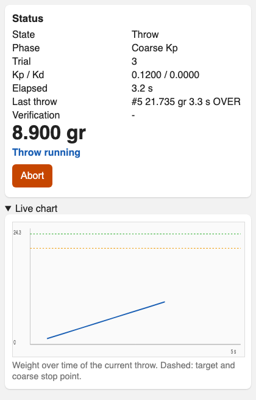

Open **Live chart** to see the weight of the running throw over time. The dashed lines are the target (green) and the coarse stop point (orange).

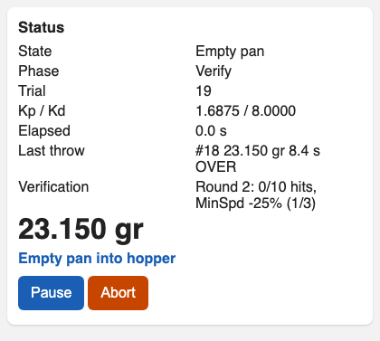

During the verification the **Verification** row shows the round, the hits so far and, after a given-up round, the correction that was made.

### Result and saving

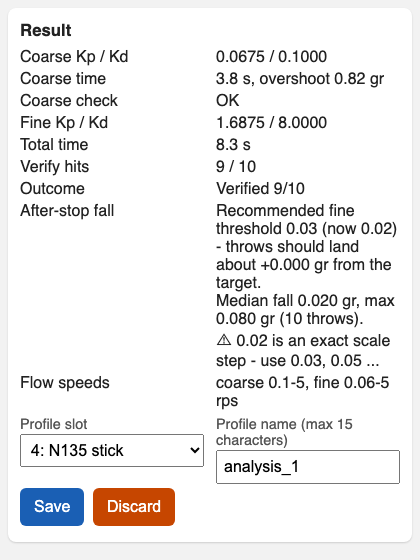

When the analysis is finished the result appears directly below the status: the coarse and fine values, times, hits and the outcome. The **After-stop fall** row shows the recommended fine threshold, where throws will land with it and the measured fall; a warning line appears when your current threshold is on an exact scale step.

Choose the **profile slot**, change the **profile name** if you like (up to 15 characters) and press **Save**, or **Discard** to leave without saving. The device asks whether to use the new profile now; answer with **Yes** or **No** here or on the display.

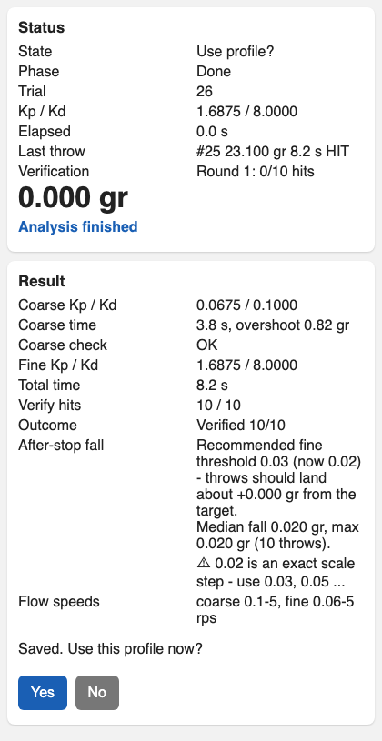

### Protocol

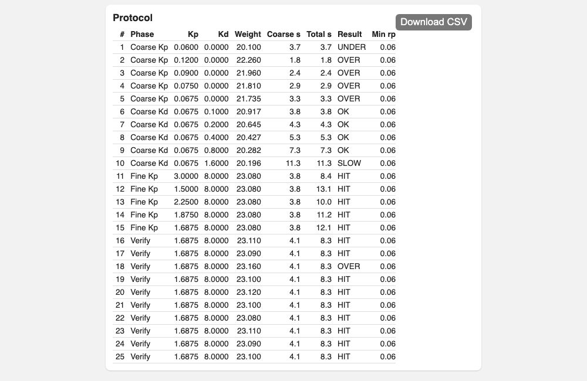

Every throw is listed with its phase, the values used, the final weight, the coarse and total time, the evaluation, the fine minimum speed and the fall after the stop. On a phone the table scrolls sideways. **Download CSV** saves the table as a file, for example to compare analyses of different powders or to send it to someone who helps you.

The protocol stays on the device until the next analysis starts, so you can open or reload the page at any time.

### Test throw (advanced)

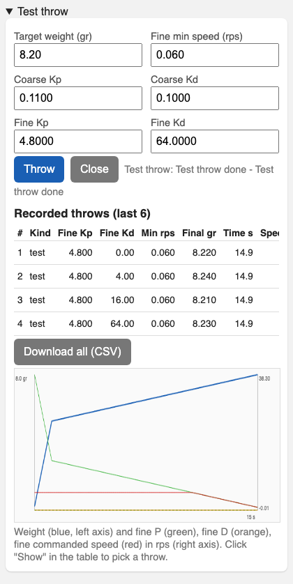

At the bottom of the page you can make single throws with values of your choice, for example to compare a result with slightly different values. Enter the target weight and the values and press **Throw**; the device must show its main menu (or "Test throw done" from a previous test throw). The pan is emptied as in the analysis.

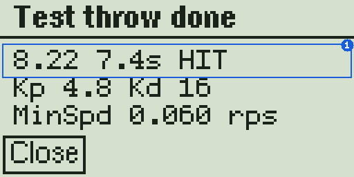

The display only shows the throw and, at the end, its result **(1)** with the values used; press either key to return to the main menu, or start the next test throw from the page.

Every throw, test throw or analysis throw, is recorded sample by sample. The last 6 recordings are listed with the final weight, the time, the fine trickler speed at the stop and the size of the P and D terms; the chart shows the weight and the fine trickler terms of the selected recording. **CSV** exports one recording, **Download all (CSV)** all of them. A test throw does not change an analysis result.

## Tips

- **Coarse powders** (large kernels such as N560): one kernel is as heavy as the tolerance, so single overthrows cannot be avoided. Use the recommended threshold and accept that the verification may end with 8 or 9 hits.
- **Use the threshold recommendation.** Change the Fine Trickler Stop Threshold to the recommended value after the analysis. If the result was not verified, run the analysis again with the new threshold; it often verifies then.
- **Repeat the analysis** after a firmware update, after mechanical changes to the trickler and for every new powder. Profiles found for one powder do not transfer to another.
- The stop thresholds are **global settings**, not part of the profile. If you tune powders with different thresholds, set the threshold again when you switch profiles.
- Keep the **hopper well filled** during the analysis. A tube that runs empty makes a throw slow or times out, and the search then works with a wrong result.

## Troubleshooting

| Symptom | Cause | What to do |
|---|---|---|
| A throw ends with `TIMEOUT` (30 s) | Hopper or tube empty, a kernel is stuck, or the start values are far too small for this powder | Refill the hopper, check the tubes. If it happens again, choose a coarser grain size or let the search continue; it doubles the values until powder flows. |
| Throws end `SLOW` | The powder flows slowly with the current values | Normal during the search. If the result says `Slower than 10 s`, the coarse trickler cannot meet the goal; the values still work, throws just take longer. |
| `Not verified` or `Overthrows, 3 corr.` | Powder keeps falling after the stop (coarse kernels), or the fine threshold is on an exact scale step | Set the recommended threshold and repeat the analysis. For very coarse powders accept the best round that was found. |
| `Trial limit reached` | 60 throws were made before the analysis could finish | Save the values anyway or repeat with the recommended threshold. Check that the hopper did not run empty. |
| The next throw does not start | The scale does not settle at zero (powder left in the pan, draught, pan not back) | Press **Pause**, clean and put back the pan, press **Zero** if available, then **Resume**. |
| **Start analysis** on the web page is grey | An analysis or test throw is already running | Continue or abort it on the device or on the page. |
| **Start analysis** does nothing | The device is in another mode (for example charge mode) | Leave that mode so the device shows its main menu, then press the button again. |
| The display warns `Stop ... F 0.02!` | The fine threshold is on an exact scale step | Set it to 0.03, 0.05 or another value between two scale steps in the charge mode settings. |
| Save is not offered on the web page | The device is not on a result screen anymore | Saving is only possible while the device shows the result pages. Repeat the analysis if it was left. |

## Limitations

- The stop thresholds are global settings of the charge mode. The analysis recommends a fine threshold but does not change it.
- The fine Kd is not searched. The D term has almost no effect in this firmware; the value from the built-in table is used.
- The start values for ball, flake and disc powders are estimates; only stick powders were measured. The search corrects them, it may just need a few more throws.
- Precharge and the servo gate ratio are not used during the analysis. The servo gate, if enabled, is opened at the start and stays open.
- The analysis cannot be started from the web page while the device is in another mode.
