# OpenTrickler Pulveranalyse

*[English](powder_analysis.md) | Deutsch*

Die Pulveranalyse ermittelt die Profilwerte für ein neues Pulver automatisch. Du gibst das Zielgewicht ein und beschreibst das Pulver, der OpenTrickler macht eine Reihe von Würfen und liefert am Ende einen geprüften Satz Werte, den du als Profil speichern kannst.

## Was die Analyse macht

Ein Profil legt fest, wie schnell die Trickler laufen (Kp) und wie stark sie vor dem Stopp bremsen (Kd). Diese Werte von Hand zu finden heißt raten, werfen, beobachten, nachstellen – und das viele Male. Die Analyse nimmt dir das ab:

1. Sie ermittelt die Werte des Grob-Tricklers (Kp und Kd).
2. Sie ermittelt den Kp des Fein-Tricklers. Der Fein-Kd kommt aus einer eingebauten Tabelle; er hat bei dieser Firmware praktisch keine Wirkung und wird deshalb nicht gesucht.
3. Sie prüft das Ergebnis mit einer Runde von 10 Würfen. Mindestens 9 davon müssen treffen.
4. Sie misst, wie viel Pulver nach dem Stopp des Fein-Tricklers noch nachfällt, und empfiehlt einen passenden **Fine Trickler Stop Threshold**.

Alles andere bleibt, wie es ist: Die Analyse liest deine Charge-Mode-Einstellungen, ändert sie aber nie. Profile werden nur geschrieben, wenn du am Ende **Save** drückst.

## Bevor du anfängst

- **Fine Trickler Stop Threshold** (Charge-Mode-Einstellungen): einen Wert *zwischen* zwei Waagenschritten wählen, zum Beispiel **0.03** oder **0.05**, nicht 0.02 oder 0.04. Liegt der Wert genau auf einem Schritt, entscheidet die Rundung der Waage, ob ein Wurf einen Schritt früher oder erst am Ziel stoppt. Die Analyse warnt am Display und auf der Webseite, wenn deine Einstellung auf einem exakten Schritt liegt.
- **Coarse Trickler Stop Threshold**: zum Beispiel 3 gr. So weit unter dem Ziel stoppt der Grob-Trickler, den Rest macht der Fein-Trickler.
- Einen **freien Profilplatz** haben oder einen, den du überschreiben willst. Das Ergebnis wird unter dem Namen `analysis_1`, `analysis_2`, … gespeichert (auf der Webseite kannst du einen beliebigen Namen eingeben, bis zu 15 Zeichen).
- Den Pulverbehälter gut füllen. Die Analyse macht etwa **20 bis 30 Würfe** und dauert **15 bis 25 Minuten**, Schale leeren eingerechnet.
- Die gewohnte Schale verwenden. Nach jedem Wurf leerst du sie in den Behälter zurück, es geht also kein Pulver verloren.

## So läuft die Analyse ab

Die Analyse ist eine Folge von Würfen. Du startest sie, füllst einmal die Rohre der Trickler, und dann wiederholen sich bis zum Ende immer dieselben zwei Schritte:

1. Der OpenTrickler wirft in die Schale.
2. Du leerst die Schale in den Behälter und stellst sie zurück. Sobald die Waage stabil auf Null steht, startet der nächste Wurf von selbst.

Das geht am Display oder auf der Webseite; beide zeigen denselben Ablauf, und beide können ihn steuern. Die Phasen, einfach erklärt:

| Phase | Was passiert | Würfe |
|---|---|---|
| Coarse Kp | Nur der Grob-Trickler läuft. Gesucht wird der kleinste Kp, der den Grob-Stopppunkt noch schnell genug erreicht (innerhalb von etwa 8 s). | 4 bis 8 |
| Coarse Kd | Die Bremse des Grob-Tricklers wird mit einigen Werten ausprobiert. Der schnellste, mit dem die Grobphase innerhalb von 10 s bleibt, gewinnt. | 2 bis 6 |
| Fine Kp | Volle Würfe. Gesucht wird der kleinste Fein-Kp, dessen Wurf innerhalb von 13 s fertig ist. Ein langsamer Fein-Trickler lässt nach dem Stopp weniger Pulver nachfallen, das ist also die präziseste Einstellung, die noch schnell genug ist. | 3 bis 6 |
| Verify | Eine Runde von 10 Würfen mit den gefundenen Werten. 9 Treffer sind nötig. Hat eine Runde 2 Überwürfe, wird sie abgebrochen, der Fein-Kp (−10 %) oder die Fein-Mindestdrehzahl (−25 %) gesenkt und eine neue Runde gestartet (höchstens 3 Korrekturen). | 10 bis 40 |

Ein **Treffer** ist ein Wurf innerhalb der Fein-Toleranz um das Ziel, der in 15 s fertig war. Spätestens nach 60 Würfen hört die Analyse auf und zeigt die besten gefundenen Werte.

## Bedienung am Display

Start im Hauptmenü: mit dem Drehknopf **Powder Analysis** wählen (nach Cleanup), drücken, Schale auf die Waage stellen und **Next** drücken.

Die Bedienung ist auf allen Bildschirmen gleich: **Drehknopf drehen** bewegt den Cursor (auf eine Ziffer, einen Listeneintrag oder eine der beiden Tasten unten), **Drehknopf drücken** bestätigt. Der **Reset-Knopf** geht meist zurück oder fragt während der Analyse, ob abgebrochen werden soll (auf den Ergebnisseiten blättert er weiter, auf der letzten verwirft er). Auf den Bildschirmen zum Schale-Leeren gibt es keinen Cursor: Drücken pausiert, Reset bricht ab.

### Zielgewicht

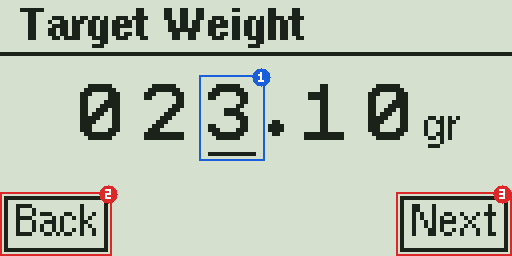

Das letzte Ladegewicht ist vorbelegt. Mit dem Drehknopf änderst du die Ziffer unter dem Cursor **(1)**, mit Drücken gehst du zur nächsten Ziffer. Nach der letzten Ziffer springt der Cursor auf **Next (3)**; nochmal drücken geht weiter. Linksdrehen führt zurück zu den Ziffern. Der Reset-Knopf ist **Back (2)** und verlässt die Analyse.

### Pulverform und Körnung

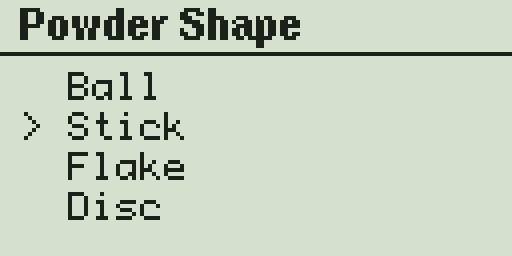

Wähle die Form der Körner (Ball, Stick, Flake, Disc) und danach die Körnung (Fine, Medium, Coarse). Diese beiden Angaben wählen die Startwerte der Suche aus. Sie müssen nicht exakt stimmen, die Suche korrigiert sie.

### Prepare

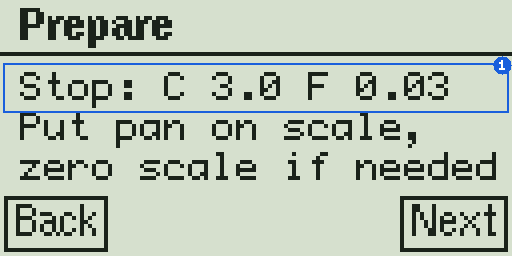

Die erste Zeile **(1)** zeigt die Stop-Thresholds deiner Charge-Mode-Einstellungen (C = grob, F = fein). Stelle die Schale auf die Waage, nulle die Waage bei Bedarf und drücke **Next**.

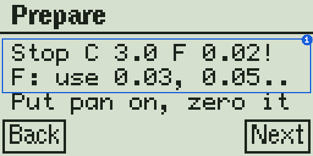

Liegt der Fein-Threshold auf einem exakten Waagenschritt, endet die Zeile mit **!** und ein Tipp zeigt die Werte, die funktionieren **(1)**. Du kannst weitermachen, aber die Verifikation wird wahrscheinlich scheitern. Besser: zurück, den Threshold in den Charge-Mode-Einstellungen ändern und neu starten.

### Flooding (Rohre füllen)

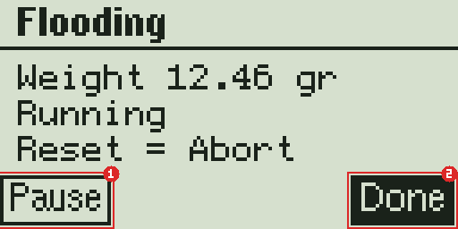

Beide Trickler laufen, damit sich die Rohre füllen. **Start / Pause (1)** schaltet die Motoren ein und aus, **Done (2)** beendet das Füllen, sobald aus beiden Rohren gleichmäßig Pulver kommt. Der Reset-Knopf bricht die Analyse ab.

### Schale leeren

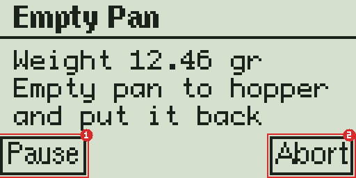

Schütte das Pulver zurück in den Behälter und stelle die Schale wieder hin. Der nächste Wurf startet, sobald die Waage stabil auf Null steht. **Pause (1)** hält zwischen zwei Würfen an (zum Beispiel zum Nachfüllen), **Abort (2)** fragt, ob du die Analyse beenden willst.

### Wurf läuft

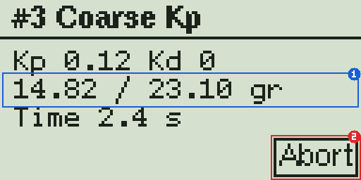

Der Titel zeigt die Wurfnummer und die Phase. Die zweite Zeile **(1)** zeigt das aktuelle Gewicht gegen das Ziel dieses Wurfs, die dritte die Zeit seit dem Start. **Abort (2)** stoppt die Motoren sofort und fragt nach.

### Wurfergebnis

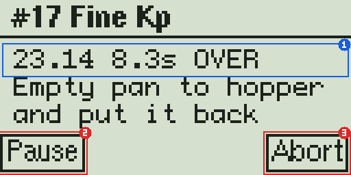

Nach jedem Wurf zeigt die erste Zeile **(1)**, was passiert ist: Endgewicht, Dauer und Bewertung (zum Beispiel `OVER`, `UNDER`, `HIT`, `OK`, `SLOW`, `TIMEOUT`). Dann die Schale leeren wie gehabt. **Pause (2)** und **Abort (3)** wirken wie beim Schale-leeren-Bildschirm.

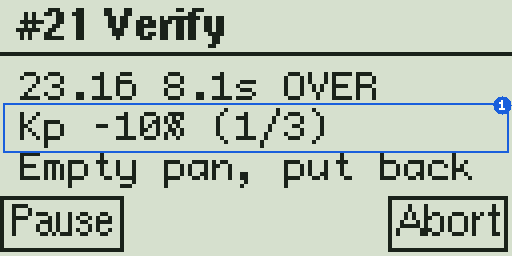

Wurde eine Verifikationsrunde abgebrochen, zeigt die zweite Zeile **(1)** die Korrektur (`Kp -10%` oder `MinSpd -25%`) und wie viele Korrekturen verbraucht sind (hier 1 von 3).

### Pause

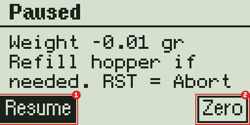

In der Pause kannst du den Behälter nachfüllen. **Resume (1)** macht weiter; der nächste Wurf startet, sobald die Schale zurück ist und die Waage stabil auf Null steht. **Zero (2)** nullt die Waage (nur sichtbar, wenn dein Waagentreiber das kann). Nur mit leerer Schale auf der Waage verwenden. Der Reset-Knopf bricht ab.

### Abbrechen

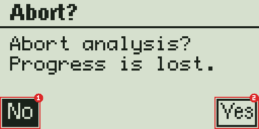

**No (1)** kehrt dorthin zurück, wo du warst, **Yes (2)** beendet die Analyse. Die bis dahin gefundenen Werte gehen verloren.

### Ergebnis 1/3: Grob-Trickler

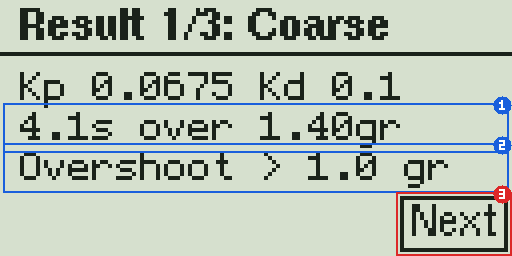

Kp und Kd des Grob-Tricklers. Zeile **(1)** zeigt die Grobzeit und wie weit der Grobwurf über den Grob-Stopppunkt hinausging. Zeile **(2)** ist eine Kontrolle: `OK` oder ein Hinweis wie `Overshoot > 1.0 gr`, `Slower than 10 s` oder `Coarse Kd too slow`. Ein Hinweis bedeutet, dass der Grob-Trickler das Ziel mit diesem Pulver nicht erreicht; die Werte sind trotzdem brauchbar. **Next (3)** geht weiter.

### Ergebnis 2/3: Fein-Trickler

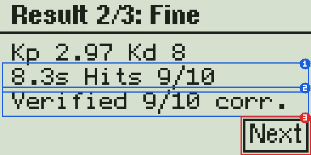

Kp und Kd des Fein-Tricklers, die Gesamtzeit eines Wurfs und die Treffer der besten Verifikationsrunde **(1)**. Zeile **(2)** ist das Fazit: `Verified 9/10` (oder `10/10`, mit `corr.`, wenn eine Korrektur nötig war), `Not verified`, `Overthrows, 3 corr.` oder `Trial limit reached`. **Next (3)** geht weiter.

### Ergebnis 3/3: Threshold

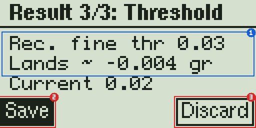

Die Analyse hat gemessen, wie viel Pulver nach dem Stopp des Fein-Tricklers nachgefallen ist, und leitet daraus einen empfohlenen **Fine Trickler Stop Threshold (1)** ab: `Rec. fine thr 0.03` ist der empfohlene Wert, `Lands ~ -0.004 gr` zeigt, wo die Würfe mit diesem Wert im Mittel landen, `Current 0.02` ist deine aktuelle Einstellung. Wenn du die Empfehlung nutzen willst, ändere die Einstellung danach im Charge Mode; die Analyse ändert sie nicht.

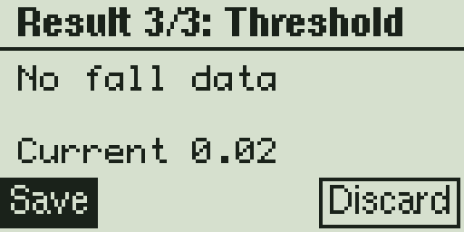

`No fall data` erscheint, wenn kein voller Wurf gemessen werden konnte.

**Save (2)** speichert die Werte auf einem Profilplatz, **Discard (3)** (auch der Reset-Knopf) verlässt die Analyse ohne zu speichern.

### Auf einem Profilplatz speichern

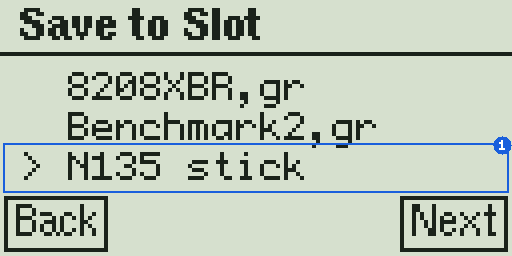

Mit dem Drehknopf den Platz wählen, der überschrieben werden soll **(1)**, und drücken. Der Reset-Knopf geht zurück.

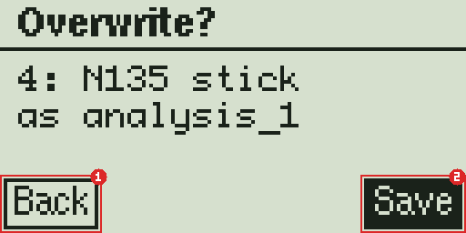

Platz und neuer Name werden noch einmal gezeigt. **Back (1)** führt zur Liste zurück, **Save (2)** schreibt das Profil.

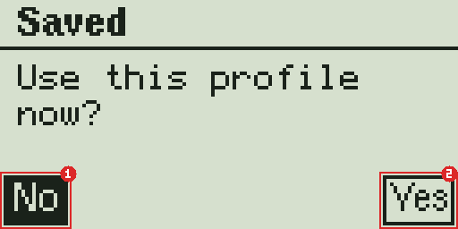

Zum Schluss kannst du das neue Profil gleich aktivieren: **Yes (2)** wählt es aus, **No (1)** behält dein aktuelles Profil. Beides führt ins Hauptmenü.

## Bedienung über die Webseite

Öffne das Webportal des OpenTricklers und drücke unten im Tab Trickler auf **Open Powder Analysis**, oder rufe direkt `http://<Adresse deines OpenTricklers>/powder_analysis` auf. Die Seite funktioniert auf dem Handy genauso wie am Computer. Die Leiste unten führt zurück ins Portal.

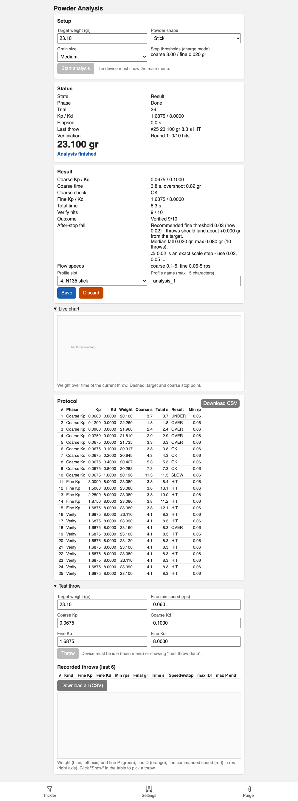

### Setup und Start

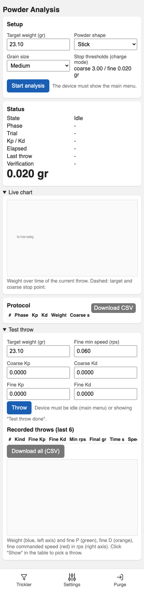

Gib Zielgewicht, Pulverform und Körnung ein und drücke **Start analysis**. Der OpenTrickler muss dafür sein Hauptmenü zeigen; er überspringt dann die Setup-Bildschirme am Display und geht direkt zu *Prepare*. Die Stop-Thresholds des Charge Mode werden zur Kontrolle angezeigt; der Ergebnisbereich warnt, wenn der Fein-Threshold auf einem exakten Waagenschritt liegt.

### Status

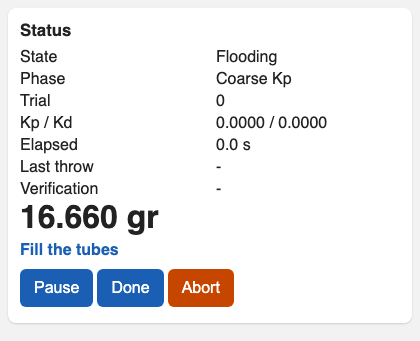

Der Statusbereich zeigt Zustand, Phase, den laufenden Wurf mit seinen Werten, das aktuelle Gewicht und eine Aufforderung, was als Nächstes zu tun ist. Darunter stehen nur die Tasten, die gerade sinnvoll sind: **Start / Pause** und **Done** beim Füllen, **Pause** und **Abort** zwischen den Würfen, **Abort** während eines Wurfs, **Resume** und **Zero scale** in der Pause.

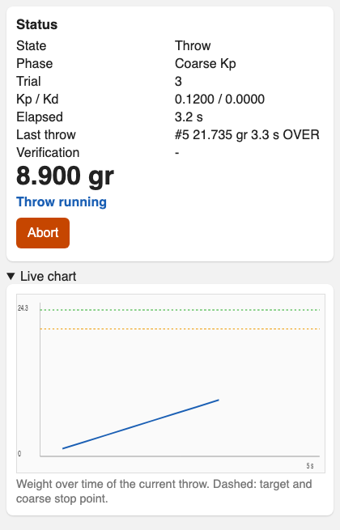

Klappe **Live chart** auf, um das Gewicht des laufenden Wurfs über der Zeit zu sehen. Die gestrichelten Linien sind das Ziel (grün) und der Grob-Stopppunkt (orange).

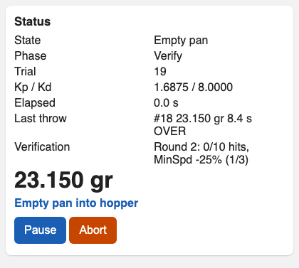

Während der Verifikation zeigt die Zeile **Verification** die Runde, die bisherigen Treffer und nach einer abgebrochenen Runde die gemachte Korrektur.

### Ergebnis und Speichern

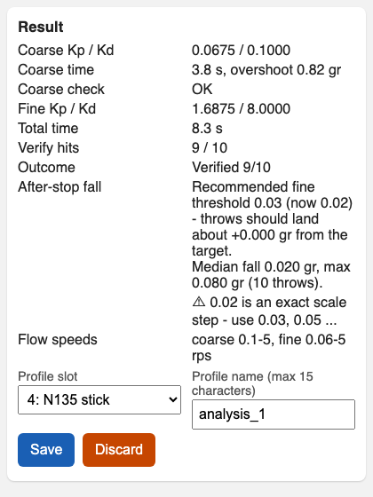

Ist die Analyse fertig, erscheint das Ergebnis direkt unter dem Status: die Grob- und Feinwerte, Zeiten, Treffer und das Fazit. Die Zeile **After-stop fall** zeigt den empfohlenen Fein-Threshold, wo die Würfe damit landen und das gemessene Nachfallen; eine Warnzeile erscheint, wenn dein aktueller Threshold auf einem exakten Waagenschritt liegt.

Wähle den **Profilplatz**, ändere bei Bedarf den **Profilnamen** (bis zu 15 Zeichen) und drücke **Save**, oder **Discard**, um ohne Speichern zu gehen. Das Gerät fragt, ob das neue Profil gleich verwendet werden soll; antworte hier oder am Display mit **Yes** oder **No**.

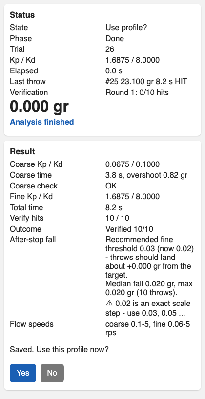

### Protokoll

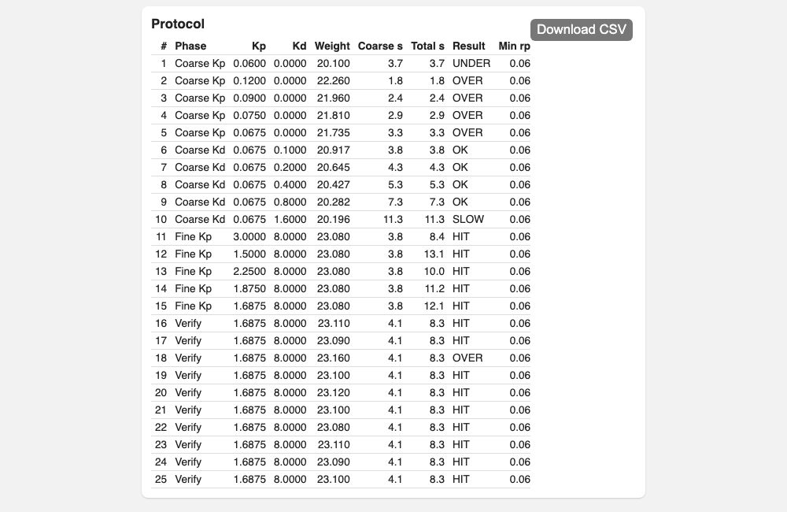

Jeder Wurf steht mit Phase, verwendeten Werten, Endgewicht, Grob- und Gesamtzeit, Bewertung, Fein-Mindestdrehzahl und Nachfallen in der Tabelle. Auf dem Handy lässt sich die Tabelle seitlich schieben. **Download CSV** speichert sie als Datei, zum Beispiel um Analysen verschiedener Pulver zu vergleichen oder sie jemandem zu schicken, der dir hilft.

Das Protokoll bleibt auf dem Gerät, bis die nächste Analyse startet. Du kannst die Seite also jederzeit öffnen oder neu laden.

### Testwurf (für Fortgeschrittene)

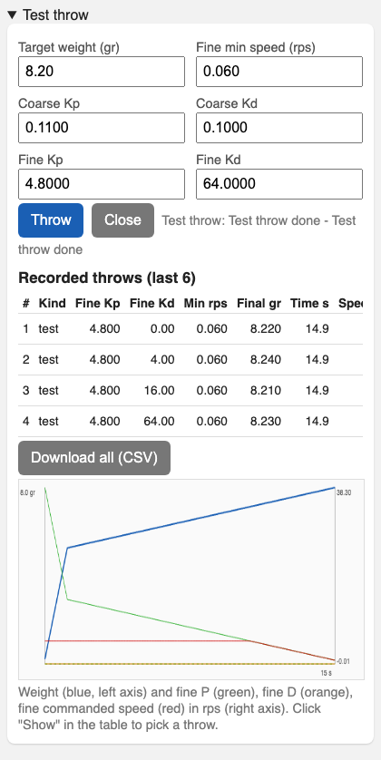

Ganz unten auf der Seite kannst du einzelne Würfe mit frei gewählten Werten machen, zum Beispiel um ein Ergebnis mit leicht veränderten Werten zu vergleichen. Gib Zielgewicht und Werte ein und drücke **Throw**; das Gerät muss sein Hauptmenü zeigen (oder „Test throw done“ von einem vorigen Testwurf). Die Schale wird geleert wie in der Analyse.

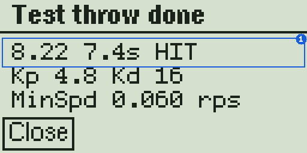

Das Display zeigt nur den Wurf und am Ende sein Ergebnis **(1)** mit den verwendeten Werten; mit einem der beiden Knöpfe geht es zurück ins Hauptmenü, oder du startest den nächsten Testwurf von der Seite aus.

Jeder Wurf, Testwurf wie Analysewurf, wird Messwert für Messwert aufgezeichnet. Die letzten 6 Aufzeichnungen stehen in der Tabelle mit Endgewicht, Zeit, Drehzahl des Fein-Tricklers beim Stopp und der Größe von P- und D-Anteil; das Diagramm zeigt Gewicht und Fein-Trickler-Anteile der gewählten Aufzeichnung. **CSV** exportiert eine Aufzeichnung, **Download all (CSV)** alle. Ein Testwurf verändert kein Analyseergebnis.

## Tipps

- **Grobe Pulver** (große Körner wie N560): Ein Korn wiegt so viel wie die Toleranz, einzelne Überwürfe lassen sich also nicht vermeiden. Nimm den empfohlenen Threshold und rechne damit, dass die Verifikation mit 8 oder 9 Treffern endet.
- **Nutze die Threshold-Empfehlung.** Stelle den Fine Trickler Stop Threshold nach der Analyse auf den empfohlenen Wert. Wurde das Ergebnis nicht verifiziert, wiederhole die Analyse mit dem neuen Threshold; oft klappt es dann.
- **Wiederhole die Analyse** nach einem Firmware-Update, nach mechanischen Änderungen am Trickler und für jedes neue Pulver. Werte eines Pulvers lassen sich nicht auf ein anderes übertragen.
- Die Stop-Thresholds sind **globale Einstellungen**, kein Teil des Profils. Wenn du Pulver mit unterschiedlichen Thresholds anlernst, stelle den Threshold beim Profilwechsel wieder passend ein.
- Halte den **Behälter während der Analyse gut gefüllt**. Ein leer laufendes Rohr macht einen Wurf langsam oder lässt ihn in den Timeout laufen, und die Suche rechnet dann mit einem falschen Ergebnis.

## Fehlerbehebung

| Symptom | Ursache | Was tun |
|---|---|---|
| Ein Wurf endet mit `TIMEOUT` (30 s) | Behälter oder Rohr leer, ein Korn klemmt, oder die Startwerte sind für dieses Pulver viel zu klein | Behälter nachfüllen, Rohre prüfen. Passiert es wieder: gröbere Körnung wählen oder die Suche weiterlaufen lassen; sie verdoppelt die Werte, bis Pulver fließt. |
| Würfe enden mit `SLOW` | Das Pulver fließt mit den aktuellen Werten langsam | Während der Suche normal. Steht im Ergebnis `Slower than 10 s`, schafft der Grob-Trickler das Ziel nicht; die Werte funktionieren trotzdem, die Würfe dauern nur länger. |
| `Not verified` oder `Overthrows, 3 corr.` | Nach dem Stopp fällt weiter Pulver nach (grobe Körner), oder der Fein-Threshold liegt auf einem exakten Waagenschritt | Empfohlenen Threshold einstellen und die Analyse wiederholen. Bei sehr groben Pulvern die beste gefundene Runde akzeptieren. |
| `Trial limit reached` | 60 Würfe waren gemacht, bevor die Analyse fertig wurde | Werte trotzdem speichern oder mit dem empfohlenen Threshold wiederholen. Prüfen, ob der Behälter leer gelaufen ist. |
| Der nächste Wurf startet nicht | Die Waage kommt nicht stabil auf Null (Pulverrest in der Schale, Luftzug, Schale nicht zurück) | **Pause** drücken, Schale säubern und zurückstellen, falls vorhanden **Zero** drücken, dann **Resume**. |
| **Start analysis** auf der Webseite ist grau | Eine Analyse oder ein Testwurf läuft bereits | Am Gerät oder auf der Seite fortsetzen oder abbrechen. |
| **Start analysis** bewirkt nichts | Das Gerät ist in einem anderen Modus (zum Beispiel im Charge Mode) | Den Modus verlassen, sodass das Gerät das Hauptmenü zeigt, und die Taste erneut drücken. |
| Das Display warnt `Stop ... F 0.02!` | Der Fein-Threshold liegt auf einem exakten Waagenschritt | In den Charge-Mode-Einstellungen auf 0.03, 0.05 oder einen anderen Wert zwischen zwei Waagenschritten stellen. |
| Auf der Webseite gibt es kein Save | Das Gerät zeigt keine Ergebnisseite mehr | Speichern geht nur, solange das Gerät die Ergebnisseiten zeigt. Analyse wiederholen, wenn sie verlassen wurde. |

## Grenzen

- Die Stop-Thresholds sind globale Einstellungen des Charge Mode. Die Analyse empfiehlt einen Fein-Threshold, ändert ihn aber nicht.
- Der Fein-Kd wird nicht gesucht. Der D-Anteil hat bei dieser Firmware praktisch keine Wirkung; der Wert aus der eingebauten Tabelle wird verwendet.
- Die Startwerte für Ball-, Flake- und Disc-Pulver sind Schätzungen; gemessen wurden nur Stäbchenpulver. Die Suche korrigiert sie, braucht dafür aber vielleicht ein paar Würfe mehr.
- Precharge und das Servo-Gate-Verhältnis werden in der Analyse nicht verwendet. Das Servo-Gate wird, falls aktiviert, zu Beginn geöffnet und bleibt offen.
- Von der Webseite aus lässt sich die Analyse nicht starten, solange das Gerät in einem anderen Modus ist.
